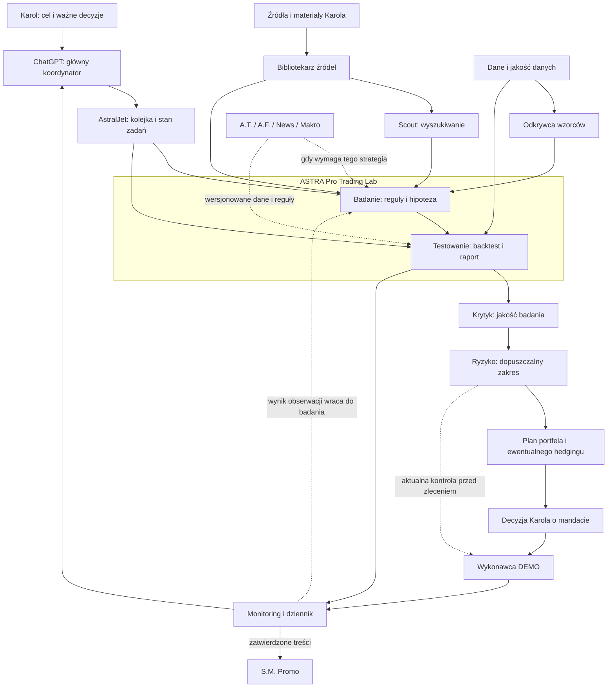

# AstralJet — struktura systemu, boty i zależności

**Wersja 0.1 do wspólnego omówienia • 19 września 2026 • dokument projektowy w Markdown.**

> Czas przestać się bawić AI, a zacząć budować i zarabiać pieniądze.

## 1. Co budujemy

**AstralJet jest całym biurem tradingowym. ASTRA Pro Trading Lab jest jego laboratorium badania i testowania strategii.**

Przyjmuję pisownię **AstralJet** z najnowszego polecenia. „ASTRA JET” z grafiki, „AURUM / ASTRA” z wcześniejszego audytu i „TradeBot Astra PRO” z kodu pozostają nazwami źródłowymi. Ten dokument porządkuje odpowiedzialności; nie zmienia automatycznie nazw repozytoriów, interfejsów ani wdrożeń. Nazwa produktu Astra nie określa obowiązkowo modelu LLM.

| Poziom | Odpowiedzialność |
|---|---|
| **Karol** | Cel, ważne decyzje, mandat działania, budżet i ryzyko |
| **ChatGPT — główny LLM** | Rozmowa, koordynacja pracy z Karolem, synteza i odbiór wyników |
| **AstralJet** | Cały system: źródła, badania, analizy, kontrola, portfel, wykonanie i monitoring |
| **ASTRA Pro Trading Lab** | Badanie dostarczonych strategii oraz ich powtarzalne testowanie |
| **Scout** | Wyszukiwanie kandydatów; dostawca pracy dla laboratorium |
| **Wykonawca DEMO** | Odrębny moduł realizacji zatwierdzonego mandatu; nie funkcja rozmowy z LLM |

Wygodny Mebel pozostaje główną pracą Karola obok rozwoju AstralJet. Inne projekty są osobnym, okazjonalnym strumieniem płatnych zleceń. Nie są botami tradingowymi ani technicznymi zależnościami Astry.

**Uzgodniony sposób współpracy:** omawiamy ustalenia; drobne poprawki wykonuję sam; ważne decyzje uzgadniamy przed wykonaniem. Zmiany strategii, ryzyka, wydatków i uruchamiania botów należą do ważnych decyzji. Niżej przedstawione granice ról i etapy są propozycją architektury do omówienia.

## 2. Co oznacza „bot” w tej strukturze

Bot oznacza tutaj **rolę z określonym zadaniem, wejściem, wynikiem i uprawnieniami**. Nie każda rola wymaga osobnego procesu, modelu lub abonamentu. Jedna aplikacja może realizować wiele ról. LLM opisuje, szuka, analizuje i wyjaśnia; obliczenia, walidacja danych, rozliczenia, kontrole ryzyka i wykonanie mają sprawdzalne reguły w kodzie.

Proponowany podział ma 19 ról, wliczając główną rolę ChatGPT. To mapa odpowiedzialności, nie plan uruchomienia 19 autonomicznych agentów. Kolejne role wydzielamy technicznie, gdy wymaga tego jakość, dostęp, koszt lub niezależny cykl pracy.

## 3. Mapa zależności



Biblioteka, dane, budżet i dziennik są usługami wspólnymi. Diagram pokazuje przepływ pracy, a nie topologię serwerów. Plan portfela wraca do kontroli ryzyka, jeśli zmienia ekspozycję; zgoda na mandat nie wyłącza późniejszych kontroli przed zleceniem.

**Zależności wymagane:** bez kompletnej reguły, odpowiednich danych i planu nie ma miarodajnego testu; bez kontroli jakości i zatwierdzonego mandatu nie ma nowego wdrożenia DEMO. **Zależności warunkowe:** fundamenty, news i makro są wymagane tylko wtedy, gdy dana strategia lub mandat z nich korzysta. Każdy taki wymóg zapisujemy w specyfikacji. Brak opcjonalnego modułu nie zatrzymuje całego biura.

## 4. Katalog ról

Kolumna „stan” w kartach opiera się na wcześniejszych odczytach z 19 września 2026, do godziny 15:06. W tej turze nie wykonywano kolejnego audytu runtime. „Niepotwierdzone” nie oznacza pewności, że dany kod nie istnieje; oznacza brak wystarczającego dowodu w dotychczasowym audycie.

| ID | Bot / rola | Główny wynik |
|---|---|---|
| AJ-00 | ChatGPT — główny koordynator Karola | Zatwierdzony przez Karola zakres ważnego zadania albo drobne zadanie w istniejącym upoważnieniu; podsumowanie postępu. |
| AJ-01 | AstralJet — orkiestrator zadań | Zlecenie dla konkretnego modułu, status zadania, lista wyników i ewentualna eskalacja do AJ-00. |
| AJ-02 | Bibliotekarz źródeł | Karta źródła SRC oraz tekst z możliwością wskazania konkretnego fragmentu. |
| AJ-03 | Scout — wyszukiwanie strategii | Karta kandydata CAND: źródła, hipoteza, reguły znalezione, braki, powód dalszego badania. |
| AJ-04 | Odkrywca wzorców | Karta hipotezy CAND z pełnym pochodzeniem danych i rejestrem przeszukanych wariantów. |
| AJ-05 | ASTRA Pro — Badacz strategii | Karta strategii STRAT w określonej wersji oraz lista pytań lub gotowy projekt planu eksperymentu. |
| AJ-06 | Dane i jakość danych | DATA-ID, zakres, hash, pochodzenie, raport jakości oraz stan GOTOWE/BRAKI/NIEODPOWIEDNIE. |
| AJ-07 | ASTRA Pro — Tester strategii | Raport RUN: transakcje, krzywa wyniku, metryki, założenia, błędy i instrukcja odtworzenia. |
| AJ-08 | Krytyk — kontrola jakości badań | REVIEW: błędy blokujące, zastrzeżenia, wymagane uzupełnienia oraz ocena jakości metodologii. |
| AJ-09 | Risk Management — kontrola ryzyka | RISK-DECISION z zakresem, czasem ważności, uzasadnieniem i decyzją DOPUSZCZONE/ZABLOKOWANE. |
| AJ-10 | A.T. — analiza techniczna | TECH-SNAPSHOT z danymi, wersją reguł, czasem i ewentualnym sygnałem. |
| AJ-11 | A.F. — analiza fundamentalna | FUND-SNAPSHOT: fakty ze źródłami, wnioski i osobno hipotezy. |
| AJ-12 | News + kalendarz | EVENT-SNAPSHOT i flagi zdarzeń; zachowana wersja sprzed późniejszych korekt, jeśli używana w testach. |
| AJ-13 | Makro i polityka globalna | MACRO-SNAPSHOT: scenariusze, założenia, horyzont, niepewność i data ważności. |
| AJ-14 | Portfel i hedging | PORTFOLIO-PLAN i opis ryzyka, które ma zostać ograniczone; plan jest propozycją do oceny. |
| AJ-15 | Wykonawca DEMO / adapter brokerski | ORDER-INTENT, wynik przyjęcia/odrzucenia, realizacje oraz stan pozycji z potwierdzeniem brokera. |
| AJ-16 | Dziennik, monitoring i raportowanie | AUDIT-LOG, stan systemu, raport eksperymentu/DEMO i konkretne zgłoszenie problemu. |
| AJ-17 | Budżet AI i utrzymanie | BUDGET-STATUS oraz zgłoszenie naprawy z przyczyną, zakresem i dowodem rozwiązania. |
| AJ-18 | S.M. Promo — komunikacja i marka | Szkic treści ze źródłami twierdzeń i listą elementów do zatwierdzenia. |

## 5. Karty odpowiedzialności

### AJ-00 · ChatGPT — główny koordynator Karola

- **Forma:** Rola LLM + rozmowa z człowiekiem
- **Cel:** Przekłada cele Karola na decyzje i zadania AstralJet. Prowadzi rozmowę o całości projektu.
- **Otrzymuje:** Polecenia Karola, aktualny plan, rejestr decyzji i raporty pozostałych ról.
- **Wykonuje:** Ustala priorytet sesji, wyjaśnia warianty, wskazuje braki i odbiera wyniki. Rozróżnia fakt, hipotezę, propozycję i decyzję Karola.
- **Oddaje:** Zatwierdzony przez Karola zakres ważnego zadania albo drobne zadanie w istniejącym upoważnieniu; podsumowanie postępu.
- **Zależy od:** Karol, AJ-16 Dziennik, AJ-17 Budżet i utrzymanie.
- **Granice uprawnień:** Może prowadzić odczyty i drobne poprawki w uzgodnionym zakresie. Zmiany strategii, ryzyka, wydatków i uruchamiania botów uzgadnia z Karolem; rozmowa nie nadaje sama dostępu do brokera.
- **Warunek odbioru:** Każda sesja kończy się wynikiem, dowodem, decyzją/propozycją, blokerem i jednym następnym krokiem.
- **Stan rozpoznania:** Uzgodniona rola w naszej współpracy; nie oznacza zainstalowanego autonomicznego zarządcy całego systemu.

### AJ-01 · AstralJet — orkiestrator zadań

- **Forma:** Proces programowy; LLM może pomagać w planowaniu
- **Cel:** Pilnuje kolejności i stanu pracy wszystkich modułów.
- **Otrzymuje:** Zadanie z ID, wersją, zakresem, budżetem, uprawnieniami i warunkiem odbioru.
- **Wykonuje:** Przekazuje pracę właściwej roli, sprawdza zależności, zapisuje stan, rozpoznaje duplikaty i zatrzymuje powtarzające się błędy.
- **Oddaje:** Zlecenie dla konkretnego modułu, status zadania, lista wyników i ewentualna eskalacja do AJ-00.
- **Zależy od:** AJ-16 rejestr stanu, AJ-17 limity, wyniki wymaganych poprzedników.
- **Granice uprawnień:** Może uruchamiać tylko dopuszczone zadania. Nie podnosi budżetu, nie uznaje nieudanego testu za udany i nie obchodzi decyzji Krytyka ani Ryzyka.
- **Warunek odbioru:** Powtórne dostarczenie tego samego zlecenia nie wywołuje drugi raz płatnej analizy ani operacji brokerskiej.
- **Stan rozpoznania:** Jest kolejka research i lokalne procesy. Jeden nadrzędny orkiestrator całego AstralJet to projekt do dopięcia.

### AJ-02 · Bibliotekarz źródeł

- **Forma:** Import danych + pomoc LLM w opisie
- **Cel:** Tworzy uporządkowaną bibliotekę materiałów, do których można wrócić i sprawdzić cytat.
- **Otrzymuje:** Filmy, PDF, książki, NotebookLM, rozmowy, artykuły i materiały przekazane przez Karola.
- **Wykonuje:** Nadaje ID źródła, zapisuje autora, URL/plik, daty, wersję i hash; wyodrębnia tekst, strony i znaczniki czasu; oznacza duplikaty i ograniczenia użycia.
- **Oddaje:** Karta źródła SRC oraz tekst z możliwością wskazania konkretnego fragmentu.
- **Zależy od:** Dostęp do materiału, AJ-17 dla ewentualnej płatnej transkrypcji, AJ-16 dla rejestru.
- **Granice uprawnień:** Nie traktuje poleceń wewnątrz źródła jako instrukcji wykonawczych. Nie zastępuje brakującego fragmentu domysłem.
- **Warunek odbioru:** Każdy cytat w dalszym procesie prowadzi do istniejącego fragmentu konkretnej wersji źródła.
- **Stan rozpoznania:** Import materiałów i katalog istnieją częściowo. Audyt wykazał m.in. blokady PDF i walidacji cytatów.

### AJ-03 · Scout — wyszukiwanie strategii

- **Forma:** Agent badawczy LLM + wyszukiwarki
- **Cel:** Znajduje opisane przez innych kandydatury strategii zgodne z naszym zakresem.
- **Otrzymuje:** Temat badań, rynek, horyzont, dozwolone źródła, budżet i katalog znanych kandydatów.
- **Wykonuje:** Szuka źródeł pierwotnych, porównuje opisy, wykrywa duplikaty i podaje brakujące reguły. Oddziela deklarowany wynik autora od wyniku sprawdzonego przez Astrę.
- **Oddaje:** Karta kandydata CAND: źródła, hipoteza, reguły znalezione, braki, powód dalszego badania.
- **Zależy od:** AJ-02, AJ-17; opcjonalnie AJ-11/12/13 dla kontekstu danego tematu.
- **Granice uprawnień:** Nie zatwierdza strategii do handlu, nie uruchamia dowolnego kodu ze źródeł, nie wybiera wyłącznie zwycięskich wyników.
- **Warunek odbioru:** Kandydat ma uzasadnienie i źródła; istniejący duplikat zostaje powiązany zamiast zbadany od nowa.
- **Stan rozpoznania:** Funkcje wyszukiwania i ekstrakcji są w research/discovery. Scout jest roboczą nazwą roli, a nie potwierdzonym osobnym wdrożeniem.

### AJ-04 · Odkrywca wzorców

- **Forma:** Eksperymenty statystyczne / ML; LLM do interpretacji
- **Cel:** Proponuje nowe hipotezy na podstawie danych, a nie tylko znalezionych opisów.
- **Otrzymuje:** Zatwierdzony zbiór danych badawczych i określone pytanie, np. zależność wyniku od zmienności.
- **Wykonuje:** Poszukuje zależności w dozwolonej części danych, zapisuje wszystkie próby i warunki powstania hipotezy, porównuje z prostym punktem odniesienia.
- **Oddaje:** Karta hipotezy CAND z pełnym pochodzeniem danych i rejestrem przeszukanych wariantów.
- **Zależy od:** AJ-06 Dane, AJ-17 budżet; wynik trafia do AJ-05, a później do AJ-07 i AJ-08.
- **Granice uprawnień:** Nie używa końcowej próby odłożonej do odkrywania wzorca. Znaleziony pattern nie otrzymuje automatycznie statusu strategii z przewagą.
- **Warunek odbioru:** Inna osoba może ustalić, na jakich danych i po ilu próbach powstała hipoteza.
- **Stan rozpoznania:** Rola ze schematu; brak potwierdzenia osobnego kompletnego modułu w audycie. Etap późniejszy.

### AJ-05 · ASTRA Pro — Badacz strategii

- **Forma:** Agent analityczny LLM + walidatory reguł
- **Cel:** Zamienia dostarczony pomysł w jednoznaczną specyfikację możliwą do przetestowania.
- **Otrzymuje:** Materiał Karola lub kandydat od Scouta/Odkrywcy wzorców; karta źródła.
- **Wykonuje:** Opisuje hipotezę, instrumenty, czas, wejścia, wyjścia, stop, wielkość pozycji, wykluczenia i koszty. Wskazuje luki. Odróżnia wierną implementację źródła od autorskiej adaptacji.
- **Oddaje:** Karta strategii STRAT w określonej wersji oraz lista pytań lub gotowy projekt planu eksperymentu.
- **Zależy od:** AJ-02 źródła, AJ-06 dane, opcjonalnie AJ-10/11/12/13; przy istotnych brakach AJ-00 i Karol.
- **Granice uprawnień:** Nie dopowiada kluczowych reguł bez oznaczenia. Istotna adaptacja wymaga omówienia i nowej wersji. Nie składa zleceń.
- **Warunek odbioru:** Dwie implementacje mogą odtworzyć te same reguły bez zgadywania. Niekompletny pomysł kończy się jawnym statusem DO_UZUPEŁNIENIA.
- **Stan rozpoznania:** Odpowiada pierwszemu blokowi drugiego zdjęcia. Ekstrakcja reguł i materiały research istnieją częściowo; jednolity kontrakt jest propozycją.

### AJ-06 · Dane i jakość danych

- **Forma:** Usługa programowa współdzielona przez laboratorium i trading
- **Cel:** Dostarcza dane odpowiednie do konkretnego pytania i wskazuje ich ograniczenia.
- **Otrzymuje:** Wymagania STRAT, eksporty i zasilanie rynkowe, specyfikacje instrumentów, kalendarze i koszty.
- **Wykonuje:** Sprawdza format, luki, duplikaty, strefę czasową, dostępność informacji w danej chwili, korekty cen i rolowanie tam, gdzie mają znaczenie. Wersjonuje zbiór i raport jakości.
- **Oddaje:** DATA-ID, zakres, hash, pochodzenie, raport jakości oraz stan GOTOWE/BRAKI/NIEODPOWIEDNIE.
- **Zależy od:** Dostawcy i adaptery rynkowe; AJ-02 dla dokumentacji danych; AJ-17 dla limitów.
- **Granice uprawnień:** Nie wypełnia luk po cichu. Brak wymaganych danych zatrzymuje dany eksperyment lub nowe wejścia; nie musi blokować niezależnych zadań.
- **Warunek odbioru:** Można odtworzyć dokładnie zbiór użyty w raporcie i wyjaśnić każdą transformację.
- **Stan rozpoznania:** Są eksporty, łącznik i biblioteki danych. Nie potwierdzono jednego pełnego kontraktu jakości dla wszystkich rynków.

### AJ-07 · ASTRA Pro — Tester strategii

- **Forma:** Deterministyczny silnik testów; LLM wyjaśnia wyniki
- **Cel:** Odpowiada liczbowo, jak konkretne reguły działały w określonych warunkach i gdzie zawodzą.
- **Otrzymuje:** STRAT, DATA-ID, plan EXP zamrożony przed wynikiem, model kosztów i wersja kodu.
- **Wykonuje:** Wykonuje backtest, sprawdza mechanikę sygnału i realizacji, koszty, dozwolone warianty parametrów, stabilność i próbę poza strojonym zbiorem. Zachowuje przegrane warianty.
- **Oddaje:** Raport RUN: transakcje, krzywa wyniku, metryki, założenia, błędy i instrukcja odtworzenia.
- **Zależy od:** AJ-05 specyfikacja, AJ-06 dane, AJ-17 zasoby; rezultat dla AJ-08 i AJ-09.
- **Granice uprawnień:** Nie zmienia kryteriów po zobaczeniu wyniku. Nie optymalizuje na odłożonej próbie końcowej. Nie wydaje zgody na rachunek realny.
- **Warunek odbioru:** Ponowny przebieg na tej samej wersji i danych odtwarza wynik w zdefiniowanej tolerancji; wszystkie warianty są w rejestrze.
- **Stan rozpoznania:** Odpowiada drugiemu blokowi drugiego zdjęcia. Istnieją silniki i historyczne testy; jednolity przebieg całego laboratorium wymaga odbioru.

### AJ-08 · Krytyk — kontrola jakości badań

- **Forma:** Oddzielny etap przeglądu + sprawdzenia programowe
- **Cel:** Szuka powodów, dla których wynik może być błędny lub niewiarygodny.
- **Otrzymuje:** Pełny pakiet STRAT/DATA/EXP/RUN, źródła, logi i lista wszystkich prób.
- **Wykonuje:** Sprawdza przeciek przyszłości, dobór próby, koszty, błędy implementacji, wybieranie zwycięzców i zgodność wniosku z danymi.
- **Oddaje:** REVIEW: błędy blokujące, zastrzeżenia, wymagane uzupełnienia oraz ocena jakości metodologii.
- **Zależy od:** AJ-05/06/07 i AJ-16; nie ocenia tylko streszczenia napisanego przez autora testu.
- **Granice uprawnień:** Może zablokować przejście z powodu błędu metodologii. Nie zmienia danych, nie podnosi limitów i nie wykonuje transakcji.
- **Warunek odbioru:** Celowo wadliwe przypadki są odrzucane, a każda uwaga wskazuje konkretny dowód. Druga odpowiedź tego samego LLM nie jest sama w sobie niezależną walidacją.
- **Stan rozpoznania:** Rola ze schematu; odrębny kompletny moduł niepotwierdzony. Na start może być procedurą przeglądu.

### AJ-09 · Risk Management — kontrola ryzyka

- **Forma:** Reguły w kodzie + analityczne uzasadnienie
- **Cel:** Sprawdza, czy planowane działanie mieści się w zatwierdzonym mandacie.
- **Otrzymuje:** Wersja strategii, portfel, otwarte pozycje, koszty, bieżące dane i limity zatwierdzone przez Karola.
- **Wykonuje:** Przed testem definiuje wymagane scenariusze ryzyka; przed demo ocenia zakres; przed zleceniem sprawdza aktualną ekspozycję i limity; w działaniu reaguje według zatwierdzonych reguł.
- **Oddaje:** RISK-DECISION z zakresem, czasem ważności, uzasadnieniem i decyzją DOPUSZCZONE/ZABLOKOWANE.
- **Zależy od:** AJ-06 dane, AJ-14 portfel, AJ-16 stan; przed uruchomieniem również AJ-08 i decyzja Karola.
- **Granice uprawnień:** Ma prawo zablokować nowe wejście. Działania ochronne wykonuje AJ-15 według wcześniej zatwierdzonych zasad. Ryzyko nie zwiększa sobie limitów.
- **Warunek odbioru:** Sytuacje graniczne mają jednoznaczny wynik; nieznany stan nie jest interpretowany jako zerowe ryzyko.
- **Stan rozpoznania:** W wykonawcach DEMO są kontrole ryzyka. Wspólna polityka całego AstralJet i jej interfejs wymagają doprecyzowania.

### AJ-10 · A.T. — analiza techniczna

- **Forma:** Obliczenia wskaźników w kodzie + komentarz LLM
- **Cel:** Dostarcza mierzalny opis rynku i sygnały wymagane przez konkretną strategię.
- **Otrzymuje:** Zweryfikowane świece/kwotowania, definicje wskaźników i STRAT.
- **Wykonuje:** Liczy wskaźniki, trend, zmienność i warunki setupu. Oznacza moment, od którego informacja była dostępna.
- **Oddaje:** TECH-SNAPSHOT z danymi, wersją reguł, czasem i ewentualnym sygnałem.
- **Zależy od:** AJ-06; AJ-05 określa, jakie elementy są potrzebne. Może być biblioteką wywoływaną przez AJ-07 i AJ-15.
- **Granice uprawnień:** Nie tworzy zlecenia na podstawie swobodnej interpretacji wykresu. Sygnał musi odpowiadać zamrożonej regule.
- **Warunek odbioru:** Te same dane i reguły dają ten sam sygnał; testy sprawdzają dostępność informacji w czasie.
- **Stan rozpoznania:** Wskaźniki i wybrane strategie są w kodzie. Pełny bot obejmujący wszystkie formacje nie jest potwierdzony.

### AJ-11 · A.F. — analiza fundamentalna

- **Forma:** Agent analityczny + obliczenia na źródłowych danych
- **Cel:** Opisuje czynniki ekonomiczne instrumentu, spółki lub sektora.
- **Otrzymuje:** Raporty spółek, dane sektorowe i informacje o instrumencie, wraz z datą publikacji.
- **Wykonuje:** Porównuje kondycję, wycenę i założenia scenariuszy. Dostosowuje zakres do aktywa: spółka, protokół krypto lub rynek surowca mają różne dane.
- **Oddaje:** FUND-SNAPSHOT: fakty ze źródłami, wnioski i osobno hipotezy.
- **Zależy od:** AJ-02, AJ-06; zadanie od AJ-01 lub AJ-05.
- **Granice uprawnień:** Nie udaje posiadania aktualnych danych. Opinia fundamentalna nie zmienia mechanicznej reguły wejścia bez nowej wersji strategii.
- **Warunek odbioru:** Istotne twierdzenia mają źródła i czas dostępności; brak informacji jest widoczny.
- **Stan rozpoznania:** Materiały i role analityczne są opisane w źródłach; autonomiczny kompletny moduł niepotwierdzony. Zależność opcjonalna, jeśli strategia go nie wymaga.

### AJ-12 · News + kalendarz

- **Forma:** Zbieranie wydarzeń + agent do syntezy
- **Cel:** Dostarcza datowane wydarzenia istotne dla wybranych instrumentów.
- **Otrzymuje:** Kalendarze publikacji, komunikaty, wiadomości i mapowanie instrumentów.
- **Wykonuje:** Odróżnia termin wydarzenia, czas publikacji i czas pobrania; wykrywa duplikaty i aktualizacje; mapuje wymagane okna wyłączenia ze STRAT.
- **Oddaje:** EVENT-SNAPSHOT i flagi zdarzeń; zachowana wersja sprzed późniejszych korekt, jeśli używana w testach.
- **Zależy od:** AJ-02, AJ-06 i dozwolone źródła; AJ-05/AJ-09 określają sposób wykorzystania.
- **Granice uprawnień:** Nagłówek nie jest samodzielnym zleceniem. Niepotwierdzony kalendarz blokuje tylko działanie, które wymaga potwierdzonego kalendarza.
- **Warunek odbioru:** Wiadomo, co system mógł wiedzieć w chwili sygnału i które wydarzenie spowodowało blokadę.
- **Stan rozpoznania:** Są elementy obsługi źródeł i warunków kalendarza; pełna usługa dla wszystkich rynków niepotwierdzona.

### AJ-13 · Makro i polityka globalna

- **Forma:** Agent analizy scenariuszy
- **Cel:** Porządkuje szerszy kontekst: gospodarka, stopy, polityka i geopolityka.
- **Otrzymuje:** Datowane dane i źródła pierwotne, wydarzenia AJ-12 oraz pytanie badawcze.
- **Wykonuje:** Przygotowuje scenariusze i wskaźniki, które mogą je potwierdzić lub podważyć. Oddziela aktualny fakt od prognozy.
- **Oddaje:** MACRO-SNAPSHOT: scenariusze, założenia, horyzont, niepewność i data ważności.
- **Zależy od:** AJ-02, AJ-06, AJ-12; wynik wykorzystuje AJ-05 lub AJ-14, jeśli mandat to przewiduje.
- **Granice uprawnień:** Nie przepisuje historii wiedzą zdobytą później i nie zmienia zleceń na podstawie samej narracji.
- **Warunek odbioru:** Każdy scenariusz ma źródła oraz warunki unieważnienia. Strategia bez tego filtra może działać niezależnie od tego modułu.
- **Stan rozpoznania:** Rola ze schematu i materiały koncepcyjne; kompletne wdrożenie niepotwierdzone.

### AJ-14 · Portfel i hedging

- **Forma:** Obliczenia ekspozycji + propozycje analityczne
- **Cel:** Łączy strategie w jeden obraz ekspozycji i sprawdza, czy deklarowane zabezpieczenie rzeczywiście ogranicza wybrane ryzyko.
- **Otrzymuje:** Dopuszczone strategie, pozycje, reguły portfela, scenariusze, koszty i ograniczenia rachunku.
- **Wykonuje:** Liczy łączną ekspozycję, koncentrację, współzależności i zachowanie w scenariuszach stresowych. Proponuje wariant alokacji lub zabezpieczenia z kosztem i ograniczeniami.
- **Oddaje:** PORTFOLIO-PLAN i opis ryzyka, które ma zostać ograniczone; plan jest propozycją do oceny.
- **Zależy od:** AJ-06, AJ-09, AJ-16; opcjonalnie AJ-11/12/13. Wykonuje go dopiero AJ-15 w zatwierdzonym zakresie.
- **Granice uprawnień:** Nie uznaje dwóch przeciwnych pozycji za automatycznie bezpieczny hedge. Nie alokuje nowego kapitału ani nie zmienia limitów bez decyzji Karola.
- **Warunek odbioru:** Plan pokazuje ekspozycję przed i po, koszty, scenariusz niepowodzenia i wpływ na pozostałe strategie.
- **Stan rozpoznania:** Współdzielenie rachunku i koordynacja rund istnieją częściowo. Pełny optymalizator portfela/hedgingu nie jest potwierdzony.

### AJ-15 · Wykonawca DEMO / adapter brokerski

- **Forma:** Deterministyczny moduł wykonawczy
- **Cel:** Realizuje wyłącznie dopuszczone działania w zatwierdzonym środowisku i zakresie.
- **Otrzymuje:** Wersja strategii i jej mandat, bieżący sygnał, ważna kontrola ryzyka oraz zweryfikowany stan brokera.
- **Wykonuje:** Sprawdza rachunek i parametry instrumentu, wysyła zlecenie, uzgadnia odpowiedź, przypisuje pozycję do strategii i realizuje dozwolone reguły zarządzania.
- **Oddaje:** ORDER-INTENT, wynik przyjęcia/odrzucenia, realizacje oraz stan pozycji z potwierdzeniem brokera.
- **Zależy od:** AJ-09, AJ-14, AJ-16, AJ-06 oraz zatwierdzenie mandatu przez Karola.
- **Granice uprawnień:** Nie interpretuje swobodnego tekstu źródła jako zlecenia. Nie ponawia niepewnej operacji bez uzgodnienia z brokerem. Nowy tryb lub istotna zmiana mandatu wymaga osobnej decyzji.
- **Warunek odbioru:** Każda realizacja ma właściciela i zgodność z dziennikiem; brak potwierdzenia jest stanem niepewnym, nie sukcesem.
- **Stan rozpoznania:** Wykonawce DEMO zostały potwierdzone w odczycie 19.09 o 15:06. Nie jest to zgoda ani plan automatycznego uruchomienia handlu realnego.

### AJ-16 · Dziennik, monitoring i raportowanie

- **Forma:** Trwały rejestr + kontrola procesów; LLM do streszczeń
- **Cel:** Utrzymuje pamięć operacyjną i dowody tego, co faktycznie się wydarzyło.
- **Otrzymuje:** Zdarzenia wszystkich modułów, wyniki eksperymentów, wersje, decyzje, pozycje i realizacje.
- **Wykonuje:** Zapisuje ślad pracy, aktualny status i powiązania. Wykrywa brak świeżych danych, zatrzymanie procesu i rozbieżność ksiąg. Przygotowuje raport do AJ-00.
- **Oddaje:** AUDIT-LOG, stan systemu, raport eksperymentu/DEMO i konkretne zgłoszenie problemu.
- **Zależy od:** Zdarzenia i odczyty modułów; trwały magazyn; AJ-17 dla obsługi awarii.
- **Granice uprawnień:** Nie zmienia wyniku eksperymentu ani historii. Korekta jest nowym wpisem. Sam status RUNNING nie stanowi dowodu poprawności procesu.
- **Warunek odbioru:** Da się odtworzyć łańcuch źródło → reguła → test → przegląd → decyzja → ewentualna realizacja.
- **Stan rozpoznania:** Dzienniki, bazy i telemetria istnieją częściowo; wspólny rejestr całego AstralJet wymaga ujednolicenia.

### AJ-17 · Budżet AI i utrzymanie

- **Forma:** Usługa programowa + wykonawca techniczny
- **Cel:** Pilnuje kosztów i poprawnego działania narzędzi, aby badania nie zatrzymywały się bez wyjaśnienia.
- **Otrzymuje:** Zatwierdzone limity, rezerwacje, zużycie dostawców, stan kolejek, wersje i logi błędów.
- **Wykonuje:** Rezerwuje i rozlicza koszt, wykrywa niepewne wywołania, ogranicza liczbę ponowień, wskazuje potrzebną naprawę. Rozróżnia limit tempa, brak środków, błędne dane i nierozliczony koszt.
- **Oddaje:** BUDGET-STATUS oraz zgłoszenie naprawy z przyczyną, zakresem i dowodem rozwiązania.
- **Zależy od:** AJ-16, źródła rozliczeń, decyzje Karola. Codex/Claude mogą realizować konkretne zadania techniczne.
- **Granice uprawnień:** Nie kupuje usług, nie podnosi limitów i nie restartuje handlu bez odpowiedniego upoważnienia. Nie rozlicza kosztu według zgadywanej wartości.
- **Warunek odbioru:** Każde płatne wywołanie ma uzgodniony stan; awaria kończy się jawną blokadą i możliwym wznowieniem bez podwójnego kosztu.
- **Stan rozpoznania:** Mechanizmy kosztów i kolejka istnieją. W audycie zapisano 19 zadań BLOCKED; usunięcia tych blokad nie potwierdzono.

### AJ-18 · S.M. Promo — komunikacja i marka

- **Forma:** Agent redakcyjny, poza ścieżką handlową
- **Cel:** Przekłada zatwierdzone osiągnięcia i materiały edukacyjne na komunikację projektu.
- **Otrzymuje:** Publicznie dopuszczone raporty, zweryfikowane wyniki i wytyczne Karola.
- **Wykonuje:** Przygotowuje szkice postów, opisów projektu i materiałów edukacyjnych. Rozróżnia demo, backtest, hipotezę i wynik rzeczywisty.
- **Oddaje:** Szkic treści ze źródłami twierdzeń i listą elementów do zatwierdzenia.
- **Zależy od:** AJ-00, AJ-16 i decyzja o dopuszczeniu materiału do publikacji.
- **Granice uprawnień:** Nie publikuje ani nie wysyła treści bez odpowiedniego zlecenia. Nie ujawnia danych rachunku, sekretów lub materiałów prywatnych.
- **Warunek odbioru:** Każde twierdzenie o wynikach daje się udowodnić i prawidłowo wskazuje rodzaj testu.
- **Stan rozpoznania:** Rola z grafiki, poza pierwszym zakresem budowy. Nie jest zależnością laboratorium ani wykonawcy.

## 6. ASTRA Pro Trading Lab — dokładnie drugi screen

Laboratorium zawiera dwie główne funkcje:

| Funkcja | Pytanie, na które odpowiada | Właściciel | Rezultat |
|---|---|---|---|
| **Badanie strategii** | Co dokładnie mamy sprawdzić, dlaczego i na jakich danych? | AJ-05 | Jednoznaczna specyfikacja i plan eksperymentu albo lista braków |
| **Testowanie strategii** | Jak te reguły zachowują się w danych i po kosztach? | AJ-07 | Odtwarzalny raport z pełną historią prób |

AJ-06 dostarcza dane. AJ-08 ocenia metodę. AJ-09 ocenia dopuszczalny zakres dalszych działań. AJ-16 przechowuje dowody. Scout znajduje kandydatów, ale Karol może przekazać strategię **bezpośrednio** do laboratorium; wyszukiwarka nie jest wymagana do każdego badania.

Optymalizacja oznacza z góry określone porównanie wariantów. Zmiana reguł po słabym wyniku tworzy nową wersję z nowym wpisem w rejestrze prób; nie usuwa poprzedniego wyniku. Podgląd próby końcowej jest odnotowywany i ogranicza jej dalsze użycie jako niezależnego sprawdzenia.

Laboratorium może analizować wyniki obserwacji DEMO i porównywać je z backtestem. Samo wysyłanie zleceń i zarządzanie pozycjami należą do AJ-15. Taki podział proponujemy dla pierwszej wersji AstralJet.

Szczegółowy zakres pracy, ekrany, stany i kryteria odbioru: [ASTRA Pro Trading Lab](ASTRA_PRO_TRADING_LAB_v0.1.md).

## 7. Uprawnienia i zatwierdzenia

| Działanie | Przygotowuje | Warunek przejścia / decyzja |
|---|---|---|
| Katalogowanie źródła | Bibliotekarz | Dozwolony dostęp i wskazane pochodzenie |
| Dodanie kandydata | Scout / Odkrywca / Karol | Jawne źródła albo opis własnej hipotezy |
| Doprecyzowanie nieistotnej etykiety | Właściciel modułu | Możliwe samodzielnie, z zapisem zmiany |
| Uzupełnienie reguły zmieniającej strategię | Badacz | Omówienie z Karolem; osobna wersja |
| Test już uzgodnionej strategii | Tester | Zamrożony plan, dane, dopuszczony budżet i zasoby |
| Dopuszczenie do rozważenia DEMO | Krytyk + Ryzyko | Kontrola metodologii, zakresu i ograniczeń |
| Uruchomienie / istotna zmiana DEMO | Wykonawca techniczny | Decyzja Karola o konkretnej wersji i mandacie |
| Zlecenie w działającym DEMO | AJ-15 | Istniejący mandat oraz aktualne reguły strategii i ryzyka; bez pytania o każde zlecenie, jeśli mandat je obejmuje |
| Wstrzymanie nowych wejść / ochrona pozycji | AJ-09 + AJ-15 | Wcześniej zatwierdzona procedura; działanie i przyczyna w dzienniku |
| Zwiększenie budżetu, zakup danych, nowy płatny serwis | AJ-17 przedstawia warianty | Decyzja Karola |
| Publikacja treści | S.M. Promo przygotowuje | Zlecenie publikacji w konkretnym zakresie |
| Handel realny | Osobny przyszły etap | Nie wynika z tego dokumentu ani z ukończenia DEMO |

Krytyk może zatrzymać przejście z powodu jakości badania, a Ryzyko z powodu warunków działania. Orkiestrator nie odwraca tych decyzji. Usunięcie blokady wymaga dowodu rozwiązania przyczyny albo jawnej zmiany zatwierdzonej polityki, nie tylko nowej odpowiedzi LLM.

## 8. Wspólne obiekty i przekazywanie pracy

| Obiekt | Właściciel | Minimalna zawartość | Odbiorca |
|---|---|---|---|
| SRC — źródło | Bibliotekarz | Autor, URL/plik, data, wersja/hash, fragment, prawa dostępu | Scout, Badacz i analitycy |
| CAND — kandydat | Scout / Odkrywca | Hipoteza, pochodzenie, zakres, braki, duplikaty, liczba prób odkrycia | Badacz |
| STRAT — strategia | Badacz | Wersja reguł, wymagane dane, koszty, wejścia/wyjścia, rozmiar pozycji i ograniczenia | Dane, Tester, Krytyk |
| DATA — zbiór | Dane | Dostawca, czas dostępności, zakres, hash, transformacje, raport jakości | Tester i analitycy |
| EXP — plan badania | Badacz + Tester | STRAT/DATA, podział, dozwolone parametry, kryteria przed wynikiem, budżet | Tester, Krytyk |
| RUN — przebieg | Tester | Wersja kodu/środowiska, parametry, seed gdy potrzebny, realizacje, metryki, błędy | Krytyk, Ryzyko, Dziennik |
| REVIEW — ocena | Krytyk | Dowody, błędy, ograniczenia i wymagane uzupełnienia | Koordynator i Ryzyko |
| MANDATE — mandat | Karol | Wersja strategii, rachunek/tryb, zakres, czas, limity, procedura zatrzymania | Ryzyko, Wykonawca |
| EVENT — zdarzenie | Każdy moduł | ID zadania, czas, autor/proces, wersja, przyczyna, wynik, koszt i odnośniki | Dziennik |

Raport z błędem technicznym nie otrzymuje etykiety „strategia odrzucona”. Brak źródła nie jest słabym wynikiem strategii. Te przypadki mają inne statusy, aby wiedzieć, czy poprawiać proces, uzupełniać materiał czy rezygnować z hipotezy.

Proponowany kontrakt zadania:

```yaml
task_id: AJ-TASK-0001
parent_task_id: null
role_id: AJ-05
goal: Zbuduj specyfikację wskazanej strategii
inputs: [SRC-0001]
strategy_version: null
required_dependencies: [source_text, source_citations]
optional_dependencies: [fundamental_context]
permissions: [read_sources, write_research_artifacts]
budget: Pobrany z zatwierdzonej konfiguracji; brak oznacza blokadę kosztu
acceptance: Reguły kompletne lub jednoznaczna lista braków
status: NEW
```

To przykład formatu, nie zapisane zlecenie. Domyślny zakres roli badawczej nie obejmuje brokera. Liczba ponowień, czas i limit kosztu są określane dla zadania; stan niepewny wymaga uzgodnienia przed ponowieniem.

## 9. Rynki — adaptery wspólnego procesu

Akcje, indeksy, krypto i surowce korzystają z tego samego obiegu dokumentów, ale z różnych kontraktów danych i wykonania. Ta sama nazwa aktywa nie oznacza tego samego instrumentu: akcja, indeks referencyjny, CFD, kontrakt futures, spot i perpetual wymagają osobnego opisu.

| Obszar | Co musi określić profil instrumentu |
|---|---|
| Akcje / indeksy | Rodzaj instrumentu, sesje, waluta, kalendarz, specyfikacja ticka i wolumenu; korekty/zdarzenia korporacyjne, jeśli dotyczą danych |
| Krypto | Rynek i miejsce obrotu, spot/pochodny/CFD, godziny, płynność, opłaty i finansowanie odpowiednie do instrumentu |
| Surowce | CFD lub konkretny kontrakt, terminy, rolowanie, jednostka, koszty utrzymania i specyfikacja wykonania |

Kosztów ani kalendarza jednego instrumentu nie przenosimy automatycznie na inny. To wymagania projektowe, nie wybór rynku do inwestowania.

## 10. Pierwszy zakres budowy

**Pierwszy rezultat: jedna dostarczona strategia przechodzi przez ASTRA Pro Trading Lab i kończy się odtwarzalnym, sprawdzonym raportem.**

1. Ustalamy jeden format STRAT, DATA, EXP i RUN oraz podział Badacz/Tester.
2. Korzystamy z istniejących bibliotek, silników i kolejki. Naprawy rozliczeń, importu i cytatów traktujemy jako zależności uruchomienia laboratorium, nie osobny projekt nadrzędny.
3. Karol podaje materiał lub wybieramy kompletną strategię z dotychczasowego repo. Scout nie jest konieczny w tym przebiegu.
4. Badacz ustala specyfikację; Dane potwierdzają przydatność zbioru; Tester wykonuje zamrożony plan.
5. Krytyk sprawdza dowody, Ryzyko opisuje warunki ewentualnego następnego etapu. Wynik negatywny lub nierozstrzygający jest pełnoprawnym rezultatem.
6. Dopiero po odbiorze tego przebiegu dołączamy automatyczne dostarczanie kandydatów przez Scouta. Pozostałych analityków uruchamiamy według potrzeb strategii.

Na tym etapie nie potrzeba równoczesnego wdrożenia autonomicznego ML, optymalizatora portfela, promocji i każdego rynku. Istniejące wykonawce DEMO zachowują swój osobny stan; nowy dokument nie uruchamia ani nie zatrzymuje rund.

## 11. Co jest ustalone, a co proponowane

**Ustalone przez Karola:** główny projekt to budowa AstralJet; ChatGPT pozostaje głównym LLM; ASTRA Pro Trading Lab obejmuje badanie i testowanie ze zdjęcia; omawiamy ustalenia, drobne poprawki wykonujemy samodzielnie, ważne decyzje wspólnie. Wygodny Mebel pozostaje główną pracą, inne projekty okazjonalne.

**Proponowane w v0.1:** 19 kart ról, rozdzielenie laboratorium od wykonawcy, identyfikatory artefaktów, stany i pierwszy zakres odbioru. Scout jest nazwą roboczą. Opis nie jest zatwierdzeniem wydatków ani migracji technicznej.

**Do wspólnego rozstrzygnięcia przy pierwszym eksperymencie:** konkretna strategia i instrument, zestaw danych, plan prób, budżet i kryteria odbioru. Częstotliwość automatycznych badań oraz ewentualny mandat DEMO ustalamy osobno. Nie ustawiono harmonogramów ani agentów działających w tle.

## 12. Podstawa i ślad źródeł

- **Photo 1.jpg:** koncepcja całego biura, relacja Karol/ChatGPT/praca/inne projekty, role analityczne, ryzyko, krytyk, poszukiwanie i rynki.
- **Photo 2.jpg:** zakres ASTRA Pro Trading Lab — „Badanie strategii” i „Testowanie strategii”.
- **Polecenia Karola w tej rozmowie:** cel, nazwy, główny LLM i sposób współpracy.
- **Audyt lokalny z 19.09, do 15:06:** źródło etykiet stanu istniejących elementów. [Audyt przekrojowy](../AURUM_ASTRA/01_AUDYT_2026-09-19.md), [AUR-001](../AURUM_ASTRA/13_AUR001_POSTEP.md).
- **Oficjalna dokumentacja OpenAI:** rozdzielenie sterowania pracą, narzędzi i przechowywania stanu jest wyborem architektury aplikacji. Nie wybrano nowego runtime ani nie zlecono migracji. [Agents](https://developers.openai.com/api/docs/guides/agents).
- **Odbiór ról:** przed wdrożeniem zapisujemy przypadek wejściowy, oczekiwany rezultat, ślad przebiegu i sprawdzenia. To sposób kontroli zachowania agenta, odrębny od oceny wyniku strategii. [Testing Agent Skills Systematically with Evals](https://developers.openai.com/blog/eval-skills).

Podział ról jest autorską propozycją na podstawie materiałów Karola, a nie gotową architekturą zalecaną przez OpenAI dla tradingu.
