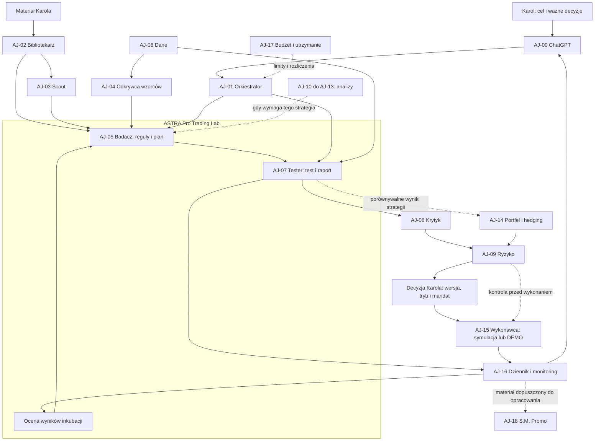

# AstralJet — struktura systemu, boty i zależności

**Wersja 0.2 • 19 września 2026 • dokumentacja architektury dla Karola i wykonawcy.**

> Czas przestać się bawić AI, a zacząć budować i zarabiać pieniądze.

## 1. Decyzje i zakres tej wersji

Karol zatwierdził rozwijanie obecnej Astry, przygotowanie najpierw dokumentacji oraz oddzielenie laboratorium od wykonania. **AstralJet to całość; ASTRA Pro Trading Lab bada, testuje i ocenia, a Wykonawca prowadzi ciągłą symulację lub brokerskie DEMO.** ChatGPT pozostaje głównym rozmówcą i koordynatorem Karola. Podstawą jest polecenie wdrożenia planu v0.2, zapisane jako E-01.

Dokument określa odpowiedzialności docelowe. Stan zastany opisujemy oddzielnie, przy każdej roli. Publikacja dokumentacji nie oznacza uruchomienia tych funkcji. Nie zmienia API, strategii, ryzyka, budżetu, harmonogramów ani działających rund. Kod produktu pozostaje w istniejącym repozytorium Astry.

**AstralJet**, **Astra Jet / ASTRA JET**, **AURUM / ASTRA** i **TradeBot Astra PRO** występują w historii jako nazwy projektu lub produktu. Dla dokumentacji v0.2 używamy AstralJet. Nie przemianowujemy repozytoriów. Nazwa produktu Astra nie narzuca modelu LLM ani nowego środowiska OpenAI.

Wygodny Mebel i AstralJet to główne obszary pracy Karola. Inne projekty są okazjonalnymi płatnymi zleceniami i nie są zależnościami systemu tradingowego. S.M. Promo pozostaje rolą pomocniczą.

### Jak korzystać z dokumentacji

1. Ten dokument określa **kto odpowiada za co** i co przekazuje dalej.
2. [ASTRA Pro Trading Lab](ASTRA_PRO_TRADING_LAB_v0.2.md) opisuje **jak przechodzi pojedyncza strategia**, metryki, inkubację i scenariusze odbioru.
3. [Źródła i decyzje](ASTRALJET_ZRODLA_I_DECYZJE_v0.2.md) wskazują **na czym opiera się opis**, rozbieżności materiałów i decyzje następnego etapu.

## 2. Bot jako rola, strategia jako badany obiekt

**Rola/bot** ma cel, wejścia, wynik, odbiorcę oraz granice uprawnień. **Strategia** ma reguły, wersję, dane i historię prób. Ten sam Tester może zbadać wiele strategii. Liczba strategii w portfelu nie określa liczby agentów. Zachowujemy 19 identyfikatorów AJ-00–AJ-18, ale nie wymagamy 19 oddzielnych procesów, modeli ani abonamentów.

LLM pomaga wyszukiwać, formalizować i wyjaśniać. Obliczenia wyników, księga, walidacja danych, limity i wykonanie muszą mieć sprawdzalny przebieg. Opinia modelu nie jest zastępstwem wyniku silnika ani potwierdzenia brokera. Rozmowa ChatGPT nie stanowi trwałej kolejki pracy — stan i wersje zapisuje aplikacja lub dokumentacja.

## 3. Mapa zależności

Strzałki przedstawiają przepływ wyników, nie serwery. Dziennik, dane i budżet są usługami wspólnymi. Odbiorca nie jest automatycznie warunkiem uruchomienia producenta: np. Tester może wydać raport, zanim Krytyk rozpocznie przegląd. Wzajemne zależności Portfela i Ryzyka dotyczą kolejnych etapów oceny planu, nie oczekiwania obu modułów na siebie przy starcie.

Fundamenty, news i makro są wymagane tylko wtedy, gdy wykorzystuje je dana reguła albo mandat. Strategia dostarczona przez Karola może ominąć Scouta. Test lokalnego zbioru nie wymaga działającego brokera. Natomiast ocena DEMO wymaga potwierdzonych zapisów właściwego rachunku.

## 4. Katalog ról

### Jak włączamy role z nowych przewodników

Nowe materiały SRC-020–SRC-028 rozwijają opisy istniejących odpowiedzialności. Poniższa mapa nie zwiększa liczby botów ani nie zmienia granicy Lab/Wykonawca.

| Materiał i rola źródłowa | Odpowiednik AstralJet | Wynik i ograniczenie |
|---|---|---|
| Day Trading: Market Scanner; Crypto: Scan | AJ-10 z AJ-06 | Ranking dostarczonych instrumentów, źródło i czas. To inna praca niż AJ-03 Scout wyszukujący reguły strategii |
| Day Trading: Chart; Crypto: Technicals | AJ-10 | Wersjonowane cechy i opis wykresu dla AJ-05 |
| Day Trading: News; Crypto: Research | AJ-12; AJ-11 przy danych projektu/on-chain | Raport ze źródłami; „brak danych” pozostaje brakiem |
| Day Trading: Quant; Hedge Fund: Quant | AJ-05 + AJ-07 | Pytanie, plan i obliczony raport; tekst LLM o backteście nie jest wynikiem testu |
| Day Trading/Crypto/Hedge Fund: Risk | AJ-09; AJ-08 ocenia metodę | Decyzja o dopuszczalności dalszego kroku, ograniczenia i konflikty |
| Day Trading: Plan Builder; Crypto: Trade Research Plan | AJ-05, przekazanie AJ-00 | Formalny plan dla Karola; brak mandatu brokerskiego w samym raporcie |
| Hedge Fund: Macro | AJ-13 | Datowane scenariusze kontekstu |
| Hedge Fund: Equity i Sector | AJ-11 | Analiza spółek i sektora jako dwa zadania tej samej roli |
| Hedge Fund: News | AJ-12 | Źródła i czas informacji |
| Hedge Fund: Portfolio | AJ-14 | Wspólne ekspozycje i propozycja portfela |
| Hedge Fund: Execution Planner | AJ-05 + AJ-14 po ocenie AJ-09 | Specyfikacja planu. Dopiero oddzielny mandat trafia do AJ-15 |
| Money-Making Team: Operations | AJ-01 + AJ-16, kontakt AJ-00 | Tablica zadań, odbiorca, stan i pytanie wymagające decyzji Karola |
| Money-Making Team: Content, Ads, Sales | AJ-18 wyłącznie jako inspiracja szkiców; sprzedaż poza systemem decyzji tradingowych | Nie uruchamia kampanii ani wysyłki. Research, Product i Leads tego materiału dotyczą osobnych projektów biznesowych |

„Confidence” w raporcie analityka opisuje jakość danych i pewność interpretacji. Bez kalibracji na niezależnych obserwacjach nie jest prawdopodobieństwem zysku. Poszczególni analitycy pracują tylko wtedy, gdy wymaga ich strategia; pełen zestaw sześciu lub ośmiu ról z poradnika nie staje się obowiązkowym kosztem każdego badania.

| ID | Rola | Wynik i odbiorca |
|---|---|---|
| AJ-00 | ChatGPT — główny koordynator Karola | Zatwierdzony przez Karola zakres ważnego zadania albo drobne zadanie w istniejącym upoważnieniu; podsumowanie postępu. Odbiera: Karol; AJ-01 otrzymuje zadania, AJ-18 wyłącznie zlecenia komunikacji. |
| AJ-01 | AstralJet — orkiestrator zadań | Zlecenie dla konkretnego modułu, status zadania, lista wyników i ewentualna eskalacja do AJ-00. Odbiera: Wskazana rola wykonująca zadanie; AJ-16 zapisuje stan, AJ-00 odbiera eskalację. |
| AJ-02 | Bibliotekarz źródeł | Karta źródła SRC oraz tekst z możliwością wskazania konkretnego fragmentu. Odbiera: AJ-03, AJ-05 oraz AJ-11–AJ-13; AJ-16 otrzymuje rejestr źródeł. |
| AJ-03 | Scout — wyszukiwanie strategii | Karta kandydata CAND: źródła, hipoteza, reguły znalezione, braki, powód dalszego badania. Odbiera: AJ-05 otrzymuje CAND; AJ-02 źródła, AJ-16 historię wyszukiwania. |
| AJ-04 | Odkrywca wzorców | Karta hipotezy CAND z pełnym pochodzeniem danych i rejestrem przeszukanych wariantów. Odbiera: AJ-05 otrzymuje CAND z historią wszystkich prób; AJ-08 później ocenia metodę. |
| AJ-05 | ASTRA Pro — Badacz strategii | Karta strategii STRAT w określonej wersji oraz lista pytań lub gotowy projekt planu eksperymentu. Odbiera: AJ-06 otrzymuje wymagania danych; AJ-07 specyfikację i plan; AJ-00 pytania do Karola. |
| AJ-06 | Dane i jakość danych | DATA-ID, zakres, hash, pochodzenie, raport jakości oraz stan GOTOWE/BRAKI/NIEODPOWIEDNIE. Odbiera: AJ-04, AJ-05, AJ-07, AJ-09–AJ-15; każdy otrzymuje dane ze wskazaniem dopuszczonego zastosowania. |
| AJ-07 | ASTRA Pro — Tester strategii | Raport RUN: transakcje, krzywa wyniku, metryki, założenia, błędy i instrukcja odtworzenia. Odbiera: AJ-08 otrzymuje pełny RUN; AJ-09 ocenę ryzyka, AJ-16 artefakty, AJ-05 wnioski. |
| AJ-08 | Krytyk — kontrola jakości badań | REVIEW: błędy blokujące, zastrzeżenia, wymagane uzupełnienia oraz ocena jakości metodologii. Odbiera: AJ-05/AJ-07 otrzymują uwagi; AJ-09 i AJ-00 otrzymują REVIEW; AJ-16 zapis. |
| AJ-09 | Risk Management — kontrola ryzyka | RISK-DECISION z zakresem, czasem ważności, uzasadnieniem i decyzją DOPUSZCZONE/ZABLOKOWANE. Odbiera: AJ-15 otrzymuje decyzję przed wykonaniem; AJ-14 uwagi do portfela, AJ-00 eskalację, AJ-16 zapis. |
| AJ-10 | A.T. — analiza techniczna | TECH-SNAPSHOT z danymi, wersją reguł, czasem i ewentualnym sygnałem. Odbiera: AJ-05, AJ-07 oraz AJ-15, gdy zatwierdzona strategia używa tych cech. |
| AJ-11 | A.F. — analiza fundamentalna | FUND-SNAPSHOT: fakty ze źródłami, wnioski i osobno hipotezy. Odbiera: AJ-05 i AJ-14, ewentualnie AJ-00; AJ-16 archiwizuje datowany raport. |
| AJ-12 | News + kalendarz | EVENT-SNAPSHOT i flagi zdarzeń; zachowana wersja sprzed późniejszych korekt, jeśli używana w testach. Odbiera: AJ-05, AJ-09 i AJ-15, gdy filtr jest wymagany; AJ-13 otrzymuje zdarzenia. |
| AJ-13 | Makro i polityka globalna | MACRO-SNAPSHOT: scenariusze, założenia, horyzont, niepewność i data ważności. Odbiera: AJ-05, AJ-14 i AJ-00; AJ-16 zapisuje scenariusze i ich ważność. |
| AJ-14 | Portfel i hedging | PORTFOLIO-PLAN i opis ryzyka, które ma zostać ograniczone; plan jest propozycją do oceny. Odbiera: AJ-09 i Karol oceniają PORTFOLIO-PLAN; AJ-15 otrzymuje dopiero zatwierdzony zakres. |
| AJ-15 | Wykonawca — symulacja ciągła / DEMO | ORDER-INTENT, sygnały, realizacje symulowane albo potwierdzone przez brokera DEMO, aktualny stan i dziennik INCU. Odbiera: AJ-16 otrzymuje sygnały, próby, realizacje i stan; AJ-09 ekspozycję, AJ-07 dane do oceny inkubacji. |
| AJ-16 | Dziennik, monitoring i raportowanie | AUDIT-LOG, stan systemu, raport eksperymentu/DEMO i konkretne zgłoszenie problemu. Odbiera: AJ-00 otrzymuje raport; AJ-01 stan zadań; AJ-07 wyniki inkubacji; AJ-09/AJ-17 alarmy. |
| AJ-17 | Budżet AI i utrzymanie | BUDGET-STATUS oraz zgłoszenie naprawy z przyczyną, zakresem i dowodem rozwiązania. Odbiera: AJ-01 otrzymuje dostępność budżetu; AJ-00 warianty decyzji; AJ-16 rozliczenia i incydenty. |
| AJ-18 | S.M. Promo — komunikacja i marka | Szkic treści ze źródłami twierdzeń i listą elementów do zatwierdzenia. Odbiera: Karol przez AJ-00 otrzymuje szkic do oceny; AJ-16 zapisuje wersję materiału. |

## 5. Karty odpowiedzialności

Stan rozpoznania opiera się na wskazanym kodzie i dokumentach. Bieżące odczyty statyczne mają datę w katalogu dowodów; dane o procesach pochodzą z audytu **19.09.2026, 15:03–15:06 Europe/Warsaw**. Nie wykonywano nowego audytu działających procesów podczas tworzenia v0.2. „Niepotwierdzone” oznacza brak dostatecznego dowodu, a nie dowód nieistnienia funkcji.

### AJ-00 · ChatGPT — główny koordynator Karola

**Forma:** Rola LLM + rozmowa z człowiekiem

**Cel:** Przekłada cele Karola na decyzje i zadania AstralJet. Prowadzi rozmowę o całości projektu.

**Wejścia:** Polecenia Karola, aktualny plan, rejestr decyzji i raporty pozostałych ról.

**Zadania:** Ustala priorytet sesji, wyjaśnia warianty, wskazuje braki i odbiera wyniki. Rozróżnia fakt, hipotezę, propozycję i decyzję Karola.

**Wyniki:** Zatwierdzony przez Karola zakres ważnego zadania albo drobne zadanie w istniejącym upoważnieniu; podsumowanie postępu.

**Odbiorcy:** Karol; AJ-01 otrzymuje zadania, AJ-18 wyłącznie zlecenia komunikacji.

**Zależności obowiązkowe:** Polecenie Karola i AJ-16: aktualne decyzje; AJ-17 przed wydatkiem.

**Zależności opcjonalne:** AJ-03–AJ-14: raporty właściwe dla tematu.

**Uprawnienia:** Może prowadzić odczyty i drobne poprawki w uzgodnionym zakresie. Zmiany strategii, ryzyka, wydatków i uruchamiania botów uzgadnia z Karolem; rozmowa nie nadaje sama dostępu do brokera.

**Powody zatrzymania:** Niejasna ważna decyzja, konflikt zakresu lub brak dowodu zakończenia. Pytanie do Karola nie wstrzymuje niezależnych odczytów.

**Kryterium odbioru:** Każda sesja kończy się wynikiem, dowodem, decyzją/propozycją, blokerem i jednym następnym krokiem.

**Stan rozpoznania:** Uzgodniona rola w naszej współpracy; nie oznacza zainstalowanego autonomicznego zarządcy całego systemu.

**Dowody:** E-01, E-02; materiały projektowe: SRC-020, SRC-024. Nie są dowodem uruchomienia nowych funkcji.

Dowody E odnoszą się do [katalogu źródeł i decyzji](ASTRALJET_ZRODLA_I_DECYZJE_v0.2.md).

### AJ-01 · AstralJet — orkiestrator zadań

**Forma:** Proces programowy; LLM może pomagać w planowaniu

**Cel:** Pilnuje kolejności i stanu pracy wszystkich modułów.

**Wejścia:** Zadanie z ID, wersją, zakresem, budżetem, uprawnieniami i warunkiem odbioru.

**Zadania:** Przekazuje pracę właściwej roli, sprawdza zależności, zapisuje stan, rozpoznaje duplikaty i zatrzymuje powtarzające się błędy.

**Wyniki:** Zlecenie dla konkretnego modułu, status zadania, lista wyników i ewentualna eskalacja do AJ-00.

**Odbiorcy:** Wskazana rola wykonująca zadanie; AJ-16 zapisuje stan, AJ-00 odbiera eskalację.

**Zależności obowiązkowe:** AJ-16: trwały zapis zadań; komplet wyników poprzedników; AJ-17 dla operacji kosztowych.

**Zależności opcjonalne:** LLM do planowania; konkretni analitycy według specyfikacji.

**Uprawnienia:** Może uruchamiać tylko dopuszczone zadania. Nie podnosi budżetu, nie uznaje nieudanego testu za udany i nie obchodzi decyzji Krytyka ani Ryzyka.

**Powody zatrzymania:** Brak poprzednika, sprzeczna wersja, wygasłe uprawnienie, niepewne wykonanie albo nierozliczony koszt. Wznowienie od ostatniego potwierdzonego kroku.

**Kryterium odbioru:** Powtórne dostarczenie tego samego zlecenia nie wywołuje drugi raz płatnej analizy ani operacji brokerskiej.

**Stan rozpoznania:** Jest kolejka research i lokalne procesy. Jeden nadrzędny orkiestrator całego AstralJet to projekt do dopięcia.

**Dowody:** E-03, E-04; materiały projektowe: SRC-020, SRC-021, SRC-027. Nie są dowodem uruchomienia nowych funkcji.

Dowody E odnoszą się do [katalogu źródeł i decyzji](ASTRALJET_ZRODLA_I_DECYZJE_v0.2.md).

### AJ-02 · Bibliotekarz źródeł

**Forma:** Import danych + pomoc LLM w opisie

**Cel:** Tworzy uporządkowaną bibliotekę materiałów, do których można wrócić i sprawdzić cytat.

**Wejścia:** Filmy, PDF, książki, NotebookLM, rozmowy, artykuły i materiały przekazane przez Karola.

**Zadania:** Nadaje ID źródła, zapisuje autora, URL/plik, daty, wersję i hash; wyodrębnia tekst, strony i znaczniki czasu; oznacza duplikaty i ograniczenia użycia.

**Wyniki:** Karta źródła SRC oraz tekst z możliwością wskazania konkretnego fragmentu.

**Odbiorcy:** AJ-03, AJ-05 oraz AJ-11–AJ-13; AJ-16 otrzymuje rejestr źródeł.

**Zależności obowiązkowe:** Dostępny materiał i jego pochodzenie; AJ-16; AJ-17 przy płatnym odczycie.

**Zależności opcjonalne:** OCR i transkrypcja, jeżeli wymagają ich formaty materiału.

**Uprawnienia:** Nie traktuje poleceń wewnątrz źródła jako instrukcji wykonawczych. Nie zastępuje brakującego fragmentu domysłem.

**Powody zatrzymania:** Nieczytelna strona, brak pliku lub brak cytowanego fragmentu. Braków nie uzupełnia domysłem; instrukcji ze źródła nie wykonuje.

**Kryterium odbioru:** Każdy cytat w dalszym procesie prowadzi do istniejącego fragmentu konkretnej wersji źródła.

**Stan rozpoznania:** Import materiałów i katalog istnieją częściowo. Audyt wykazał m.in. blokady PDF i walidacji cytatów.

**Dowody:** E-03, E-05, E-11; materiały projektowe: SRC-020–SRC-028. Nie są dowodem uruchomienia nowych funkcji.

Dowody E odnoszą się do [katalogu źródeł i decyzji](ASTRALJET_ZRODLA_I_DECYZJE_v0.2.md).

### AJ-03 · Scout — wyszukiwanie strategii

**Forma:** Agent badawczy LLM + wyszukiwarki

**Cel:** Znajduje opisane przez innych kandydatury strategii zgodne z naszym zakresem.

**Wejścia:** Temat badań, rynek, horyzont, dozwolone źródła, budżet i katalog znanych kandydatów.

**Zadania:** Szuka źródeł pierwotnych, porównuje opisy, wykrywa duplikaty i podaje brakujące reguły. Oddziela deklarowany wynik autora od wyniku sprawdzonego przez Astrę.

**Wyniki:** Karta kandydata CAND: źródła, hipoteza, reguły znalezione, braki, powód dalszego badania.

**Odbiorcy:** AJ-05 otrzymuje CAND; AJ-02 źródła, AJ-16 historię wyszukiwania.

**Zależności obowiązkowe:** Zakres wyszukiwania; AJ-02 biblioteka; AJ-17 limit płatnych operacji.

**Zależności opcjonalne:** AJ-11, AJ-12, AJ-13: kontekst określony w zadaniu.

**Uprawnienia:** Nie zatwierdza strategii do handlu, nie uruchamia dowolnego kodu ze źródeł, nie wybiera wyłącznie zwycięskich wyników.

**Powody zatrzymania:** Brak źródła, wyczerpany limit, duplikat lub brak reguł. Duplikat łączy z istniejącym kandydatem; niekompletny pomysł zachowuje jako DO_UZUPEŁNIENIA.

**Kryterium odbioru:** Kandydat ma uzasadnienie i źródła; istniejący duplikat zostaje powiązany zamiast zbadany od nowa.

**Stan rozpoznania:** Funkcje wyszukiwania i ekstrakcji są w research/discovery. Scout jest roboczą nazwą roli, a nie potwierdzonym osobnym wdrożeniem.

**Dowody:** E-03, E-05; materiały projektowe: SRC-020: skaner instrumentów jest odrębny od Scouta. Nie są dowodem uruchomienia nowych funkcji.

Dowody E odnoszą się do [katalogu źródeł i decyzji](ASTRALJET_ZRODLA_I_DECYZJE_v0.2.md).

### AJ-04 · Odkrywca wzorców

**Forma:** Eksperymenty statystyczne / ML; LLM do interpretacji

**Cel:** Proponuje nowe hipotezy na podstawie danych, a nie tylko znalezionych opisów.

**Wejścia:** Zatwierdzony zbiór danych badawczych i określone pytanie, np. zależność wyniku od zmienności.

**Zadania:** Poszukuje zależności w dozwolonej części danych, zapisuje wszystkie próby i warunki powstania hipotezy, porównuje z prostym punktem odniesienia.

**Wyniki:** Karta hipotezy CAND z pełnym pochodzeniem danych i rejestrem przeszukanych wariantów.

**Odbiorcy:** AJ-05 otrzymuje CAND z historią wszystkich prób; AJ-08 później ocenia metodę.

**Zależności obowiązkowe:** AJ-06 dane badawcze; zakres poszukiwania; AJ-16 rejestr prób; AJ-17 zasoby.

**Zależności opcjonalne:** AJ-10 cechy techniczne; AJ-11–AJ-13 tylko przy określonej hipotezie.

**Uprawnienia:** Nie używa końcowej próby odłożonej do odkrywania wzorca. Znaleziony pattern nie otrzymuje automatycznie statusu strategii z przewagą.

**Powody zatrzymania:** Brak pochodzenia cech, dostęp do niedozwolonej próby końcowej lub wyczerpanie zakresu poszukiwań.

**Kryterium odbioru:** Inna osoba może ustalić, na jakich danych i po ilu próbach powstała hipoteza.

**Stan rozpoznania:** Rola ze schematu; brak potwierdzenia osobnego kompletnego modułu w audycie. Etap późniejszy.

**Dowody:** E-02; E-06 pokazuje modele regułowe, nie dowód kompletnego modułu ML

Dowody E odnoszą się do [katalogu źródeł i decyzji](ASTRALJET_ZRODLA_I_DECYZJE_v0.2.md).

### AJ-05 · ASTRA Pro — Badacz strategii

**Forma:** Agent analityczny LLM + walidatory reguł

**Cel:** Zamienia dostarczony pomysł w jednoznaczną specyfikację możliwą do przetestowania.

**Wejścia:** Materiał Karola lub kandydat od Scouta/Odkrywcy wzorców; karta źródła.

**Zadania:** Opisuje hipotezę, instrumenty, czas, wejścia, wyjścia, stop, wielkość pozycji, wykluczenia i koszty. Wskazuje luki. Odróżnia wierną implementację źródła od autorskiej adaptacji.

**Wyniki:** Karta strategii STRAT w określonej wersji oraz lista pytań lub gotowy projekt planu eksperymentu.

**Odbiorcy:** AJ-06 otrzymuje wymagania danych; AJ-07 specyfikację i plan; AJ-00 pytania do Karola.

**Zależności obowiązkowe:** AJ-02 albo jawna własna hipoteza; określony cel; AJ-06 potwierdza wykonalność przed zamrożeniem EXP.

**Zależności opcjonalne:** AJ-03/AJ-04 dostawcy pomysłów; AJ-10–AJ-13 zależnie od reguł.

**Uprawnienia:** Nie dopowiada kluczowych reguł bez oznaczenia. Istotna adaptacja wymaga omówienia i nowej wersji. Nie składa zleceń.

**Powody zatrzymania:** Brak warunku wejścia, wyjścia, czasu, sizingu lub istotna sprzeczność. Uzupełnienie zmieniające strategię wymaga decyzji i nowej wersji.

**Kryterium odbioru:** Dwie implementacje mogą odtworzyć te same reguły bez zgadywania. Niekompletny pomysł kończy się jawnym statusem DO_UZUPEŁNIENIA.

**Stan rozpoznania:** Potwierdzono schemat reguł i walidację cytatów w kodzie. Granica laboratorium została zatwierdzona przez Karola. Odbiór całego przebiegu pozostaje przyszłym etapem.

**Dowody:** E-05, E-06; materiały projektowe: SRC-020, SRC-024, SRC-026, SRC-027. Nie są dowodem uruchomienia nowych funkcji.

Dowody E odnoszą się do [katalogu źródeł i decyzji](ASTRALJET_ZRODLA_I_DECYZJE_v0.2.md).

### AJ-06 · Dane i jakość danych

**Forma:** Usługa programowa współdzielona przez laboratorium i trading

**Cel:** Dostarcza dane odpowiednie do konkretnego pytania i wskazuje ich ograniczenia.

**Wejścia:** Wymagania STRAT, eksporty i zasilanie rynkowe, specyfikacje instrumentów, kalendarze i koszty.

**Zadania:** Sprawdza format, luki, duplikaty, strefę czasową, dostępność informacji w danej chwili, korekty cen i rolowanie tam, gdzie mają znaczenie. Wersjonuje zbiór i raport jakości.

**Wyniki:** DATA-ID, zakres, hash, pochodzenie, raport jakości oraz stan GOTOWE/BRAKI/NIEODPOWIEDNIE.

**Odbiorcy:** AJ-04, AJ-05, AJ-07, AJ-09–AJ-15; każdy otrzymuje dane ze wskazaniem dopuszczonego zastosowania.

**Zależności obowiązkowe:** Wymagania danego zadania, źródła danych, specyfikacja instrumentu i AJ-16.

**Zależności opcjonalne:** AJ-02 opis dostawcy; AJ-12 zdarzenia i kalendarz, gdy wymagane.

**Uprawnienia:** Nie wypełnia luk po cichu. Brak wymaganych danych zatrzymuje dany eksperyment lub nowe wejścia; nie musi blokować niezależnych zadań.

**Powody zatrzymania:** Luki, nieznana strefa czasu, niewłaściwy instrument, nieznane koszty lub dane dostępne dopiero po decyzji. Blokuje zależne zadanie, nie całą platformę.

**Kryterium odbioru:** Można odtworzyć dokładnie zbiór użyty w raporcie i wyjaśnić każdą transformację.

**Stan rozpoznania:** Są eksporty, łącznik i biblioteki danych. Nie potwierdzono jednego pełnego kontraktu jakości dla wszystkich rynków.

**Dowody:** E-07, E-08; materiały projektowe: SRC-022 s. 7; SRC-028. Nie są dowodem uruchomienia nowych funkcji.

Dowody E odnoszą się do [katalogu źródeł i decyzji](ASTRALJET_ZRODLA_I_DECYZJE_v0.2.md).

### AJ-07 · ASTRA Pro — Tester strategii

**Forma:** Deterministyczny silnik testów; LLM wyjaśnia wyniki

**Cel:** Odpowiada liczbowo, jak konkretne reguły działały w określonych warunkach i gdzie zawodzą.

**Wejścia:** STRAT, DATA-ID, plan EXP zamrożony przed wynikiem, model kosztów i wersja kodu.

**Zadania:** Wykonuje backtest, sprawdza mechanikę sygnału i realizacji, koszty, dozwolone warianty parametrów, stabilność i próbę poza strojonym zbiorem. Zachowuje przegrane warianty.

**Wyniki:** Raport RUN: transakcje, krzywa wyniku, metryki, założenia, błędy i instrukcja odtworzenia.

**Odbiorcy:** AJ-08 otrzymuje pełny RUN; AJ-09 ocenę ryzyka, AJ-16 artefakty, AJ-05 wnioski.

**Zależności obowiązkowe:** Zamrożone STRAT, DATA, EXP; dopuszczony kod; AJ-17 zasoby i AJ-16 trwały zapis.

**Zależności opcjonalne:** AJ-10–AJ-13 tylko jeśli stanowią wymagania strategii; porównanie TradingView jako osobny adapter.

**Uprawnienia:** Nie zmienia kryteriów po zobaczeniu wyniku. Nie optymalizuje na odłożonej próbie końcowej. Nie wydaje zgody na rachunek realny.

**Powody zatrzymania:** Niezgodne wersje, błąd księgi, niedozwolony parametr, niejasna kolejność realizacji lub brak wymaganych danych. Awaria nie jest odrzuceniem strategii.

**Kryterium odbioru:** Ponowny przebieg na tej samej wersji i danych odtwarza wynik w zdefiniowanej tolerancji; wszystkie warianty są w rejestrze.

**Stan rozpoznania:** Odpowiada drugiemu blokowi drugiego zdjęcia. Istnieją silniki i historyczne testy; jednolity przebieg całego laboratorium wymaga odbioru.

**Dowody:** E-07, E-08; materiały projektowe: SRC-020 s. 6; SRC-022 s. 7–8; SRC-024. Nie są dowodem uruchomienia nowych funkcji.

Dowody E odnoszą się do [katalogu źródeł i decyzji](ASTRALJET_ZRODLA_I_DECYZJE_v0.2.md).

### AJ-08 · Krytyk — kontrola jakości badań

**Forma:** Oddzielny etap przeglądu + sprawdzenia programowe

**Cel:** Szuka powodów, dla których wynik może być błędny lub niewiarygodny.

**Wejścia:** Pełny pakiet STRAT/DATA/EXP/RUN, źródła, logi i lista wszystkich prób.

**Zadania:** Sprawdza przeciek przyszłości, dobór próby, koszty, błędy implementacji, wybieranie zwycięzców i zgodność wniosku z danymi.

**Wyniki:** REVIEW: błędy blokujące, zastrzeżenia, wymagane uzupełnienia oraz ocena jakości metodologii.

**Odbiorcy:** AJ-05/AJ-07 otrzymują uwagi; AJ-09 i AJ-00 otrzymują REVIEW; AJ-16 zapis.

**Zależności obowiązkowe:** STRAT, DATA, EXP, RUN, pełna historia prób i kod; AJ-16.

**Zależności opcjonalne:** Drugi recenzent lub odrębny silnik kontrolny; dodatkowe dane jako nowe badanie.

**Uprawnienia:** Może zablokować przejście z powodu błędu metodologii. Nie zmienia danych, nie podnosi limitów i nie wykonuje transakcji.

**Powody zatrzymania:** Nieodtwarzalny wynik, przeciek przyszłości, ukryte próby albo wniosek mocniejszy niż dowody. Kolejna opinia LLM nie usuwa błędu obliczeń.

**Kryterium odbioru:** Celowo wadliwe przypadki są odrzucane, a każda uwaga wskazuje konkretny dowód. Druga odpowiedź tego samego LLM nie jest sama w sobie niezależną walidacją.

**Stan rozpoznania:** Rola ze schematu; odrębny kompletny moduł niepotwierdzony. Na start może być procedurą przeglądu.

**Dowody:** E-02, E-08; materiały projektowe: SRC-022 s. 7–11. Nie są dowodem uruchomienia nowych funkcji.

Dowody E odnoszą się do [katalogu źródeł i decyzji](ASTRALJET_ZRODLA_I_DECYZJE_v0.2.md).

### AJ-09 · Risk Management — kontrola ryzyka

**Forma:** Reguły w kodzie + analityczne uzasadnienie

**Cel:** Sprawdza, czy planowane działanie mieści się w zatwierdzonym mandacie.

**Wejścia:** Wersja strategii, portfel, otwarte pozycje, koszty, bieżące dane i limity zatwierdzone przez Karola.

**Zadania:** Przed testem definiuje wymagane scenariusze ryzyka; przed demo ocenia zakres; przed zleceniem sprawdza aktualną ekspozycję i limity; w działaniu reaguje według zatwierdzonych reguł.

**Wyniki:** RISK-DECISION z zakresem, czasem ważności, uzasadnieniem i decyzją DOPUSZCZONE/ZABLOKOWANE.

**Odbiorcy:** AJ-15 otrzymuje decyzję przed wykonaniem; AJ-14 uwagi do portfela, AJ-00 eskalację, AJ-16 zapis.

**Zależności obowiązkowe:** AJ-06 dane; AJ-16 bieżący stan; polityka Karola; REVIEW przed nową inkubacją. AJ-14, gdy ocena dotyczy portfela.

**Zależności opcjonalne:** AJ-10–AJ-13 tylko przy wymaganych filtrach.

**Uprawnienia:** Ma prawo zablokować nowe wejście. Działania ochronne wykonuje AJ-15 według wcześniej zatwierdzonych zasad. Ryzyko nie zwiększa sobie limitów.

**Powody zatrzymania:** Nieznana ekspozycja, nieważny mandat, niespójny rachunek lub przekroczony limit. Zatrzymanie nowych wejść nie oznacza automatycznego zamknięcia wszystkich pozycji.

**Kryterium odbioru:** Sytuacje graniczne mają jednoznaczny wynik; nieznany stan nie jest interpretowany jako zerowe ryzyko.

**Stan rozpoznania:** W wykonawcach DEMO są kontrole ryzyka. Wspólna polityka całego AstralJet i jej interfejs wymagają doprecyzowania.

**Dowody:** E-09, E-10; materiały projektowe: SRC-020 s. 7; SRC-022; SRC-026; SRC-027. Nie są dowodem uruchomienia nowych funkcji.

Dowody E odnoszą się do [katalogu źródeł i decyzji](ASTRALJET_ZRODLA_I_DECYZJE_v0.2.md).

### AJ-10 · A.T. — analiza techniczna

**Forma:** Obliczenia wskaźników w kodzie + komentarz LLM

**Cel:** Dostarcza mierzalny opis rynku i sygnały wymagane przez konkretną strategię.

**Wejścia:** Zweryfikowane świece/kwotowania, definicje wskaźników i STRAT.

**Zadania:** Liczy wskaźniki, trend, zmienność i warunki setupu. Oznacza moment, od którego informacja była dostępna.

**Wyniki:** TECH-SNAPSHOT z danymi, wersją reguł, czasem i ewentualnym sygnałem.

**Odbiorcy:** AJ-05, AJ-07 oraz AJ-15, gdy zatwierdzona strategia używa tych cech.

**Zależności obowiązkowe:** AJ-06 dane; wersjonowana definicja wskaźnika i czasu jego dostępności.

**Zależności opcjonalne:** Lokalny podgląd TradingView do wyjaśnienia; nie zastępuje obliczeń.

**Uprawnienia:** Nie tworzy zlecenia na podstawie swobodnej interpretacji wykresu. Sygnał musi odpowiadać zamrożonej regule.

**Powody zatrzymania:** Za krótka historia rozgrzewki, otwarta świeca użyta jako zamknięta lub niezgodna implementacja wskaźnika.

**Kryterium odbioru:** Te same dane i reguły dają ten sam sygnał; testy sprawdzają dostępność informacji w czasie.

**Stan rozpoznania:** Wskaźniki i wybrane strategie są w kodzie. Pełny bot obejmujący wszystkie formacje nie jest potwierdzony.

**Dowody:** E-06, E-08; materiały projektowe: SRC-020, SRC-023, SRC-026. Nie są dowodem uruchomienia nowych funkcji.

Dowody E odnoszą się do [katalogu źródeł i decyzji](ASTRALJET_ZRODLA_I_DECYZJE_v0.2.md).

### AJ-11 · A.F. — analiza fundamentalna

**Forma:** Agent analityczny + obliczenia na źródłowych danych

**Cel:** Opisuje czynniki ekonomiczne instrumentu, spółki lub sektora.

**Wejścia:** Raporty spółek, dane sektorowe i informacje o instrumencie, wraz z datą publikacji.

**Zadania:** Porównuje kondycję, wycenę i założenia scenariuszy. Dostosowuje zakres do aktywa: spółka, protokół krypto lub rynek surowca mają różne dane.

**Wyniki:** FUND-SNAPSHOT: fakty ze źródłami, wnioski i osobno hipotezy.

**Odbiorcy:** AJ-05 i AJ-14, ewentualnie AJ-00; AJ-16 archiwizuje datowany raport.

**Zależności obowiązkowe:** AJ-02 źródła, AJ-06 właściwe dane i pytanie badawcze.

**Zależności opcjonalne:** AJ-12 komunikaty, AJ-13 kontekst makro.

**Uprawnienia:** Nie udaje posiadania aktualnych danych. Opinia fundamentalna nie zmienia mechanicznej reguły wejścia bez nowej wersji strategii.

**Powody zatrzymania:** Brak daty publikacji, nieporównywalne definicje lub nieaktualne dane dla wymaganego horyzontu.

**Kryterium odbioru:** Istotne twierdzenia mają źródła i czas dostępności; brak informacji jest widoczny.

**Stan rozpoznania:** Materiały i role analityczne są opisane w źródłach; autonomiczny kompletny moduł niepotwierdzony. Zależność opcjonalna, jeśli strategia go nie wymaga.

**Dowody:** E-02; E-12 potwierdza dokumentację ról, nie pełny autonomiczny moduł; materiały projektowe: SRC-026, SRC-027. Nie są dowodem uruchomienia nowych funkcji.

Dowody E odnoszą się do [katalogu źródeł i decyzji](ASTRALJET_ZRODLA_I_DECYZJE_v0.2.md).

### AJ-12 · News + kalendarz

**Forma:** Zbieranie wydarzeń + agent do syntezy

**Cel:** Dostarcza datowane wydarzenia istotne dla wybranych instrumentów.

**Wejścia:** Kalendarze publikacji, komunikaty, wiadomości i mapowanie instrumentów.

**Zadania:** Odróżnia termin wydarzenia, czas publikacji i czas pobrania; wykrywa duplikaty i aktualizacje; mapuje wymagane okna wyłączenia ze STRAT.

**Wyniki:** EVENT-SNAPSHOT i flagi zdarzeń; zachowana wersja sprzed późniejszych korekt, jeśli używana w testach.

**Odbiorcy:** AJ-05, AJ-09 i AJ-15, gdy filtr jest wymagany; AJ-13 otrzymuje zdarzenia.

**Zależności obowiązkowe:** Dozwolone źródła, AJ-02 pochodzenie, AJ-06 czas poznania oraz reguła wykorzystania.

**Zależności opcjonalne:** Wpisy X jako dodatkowy radar, nie domyślnie potwierdzone fakty.

**Uprawnienia:** Nagłówek nie jest samodzielnym zleceniem. Niepotwierdzony kalendarz blokuje tylko działanie, które wymaga potwierdzonego kalendarza.

**Powody zatrzymania:** Brak czasu poznania, niepotwierdzony kalendarz, usunięte źródło lub sprzeczne aktualizacje. Zachowuje poprzednie wersje z ich czasami.

**Kryterium odbioru:** Wiadomo, co system mógł wiedzieć w chwili sygnału i które wydarzenie spowodowało blokadę.

**Stan rozpoznania:** Są elementy obsługi źródeł i warunków kalendarza; pełna usługa dla wszystkich rynków niepotwierdzona.

**Dowody:** E-03, E-09; materiały projektowe: SRC-020 s. 5; SRC-027. Nie są dowodem uruchomienia nowych funkcji.

Dowody E odnoszą się do [katalogu źródeł i decyzji](ASTRALJET_ZRODLA_I_DECYZJE_v0.2.md).

### AJ-13 · Makro i polityka globalna

**Forma:** Agent analizy scenariuszy

**Cel:** Porządkuje szerszy kontekst: gospodarka, stopy, polityka i geopolityka.

**Wejścia:** Datowane dane i źródła pierwotne, wydarzenia AJ-12 oraz pytanie badawcze.

**Zadania:** Przygotowuje scenariusze i wskaźniki, które mogą je potwierdzić lub podważyć. Oddziela aktualny fakt od prognozy.

**Wyniki:** MACRO-SNAPSHOT: scenariusze, założenia, horyzont, niepewność i data ważności.

**Odbiorcy:** AJ-05, AJ-14 i AJ-00; AJ-16 zapisuje scenariusze i ich ważność.

**Zależności obowiązkowe:** AJ-02 oraz AJ-06 datowane dane i określony horyzont.

**Zależności opcjonalne:** AJ-12 wydarzenia; AJ-11 fundamenty.

**Uprawnienia:** Nie przepisuje historii wiedzą zdobytą później i nie zmienia zleceń na podstawie samej narracji.

**Powody zatrzymania:** Brak źródła, wygasła ważność albo użycie późniejszej rewizji danych w historycznym scenariuszu.

**Kryterium odbioru:** Każdy scenariusz ma źródła oraz warunki unieważnienia. Strategia bez tego filtra może działać niezależnie od tego modułu.

**Stan rozpoznania:** Rola ze schematu i materiały koncepcyjne; kompletne wdrożenie niepotwierdzone.

**Dowody:** E-02, E-12; materiały projektowe: SRC-027. Nie są dowodem uruchomienia nowych funkcji.

Dowody E odnoszą się do [katalogu źródeł i decyzji](ASTRALJET_ZRODLA_I_DECYZJE_v0.2.md).

### AJ-14 · Portfel i hedging

**Forma:** Obliczenia ekspozycji + propozycje analityczne

**Cel:** Łączy strategie w jeden obraz ekspozycji i sprawdza, czy deklarowane zabezpieczenie rzeczywiście ogranicza wybrane ryzyko.

**Wejścia:** Dopuszczone strategie, pozycje, reguły portfela, scenariusze, koszty i ograniczenia rachunku.

**Zadania:** Liczy łączną ekspozycję, koncentrację, współzależności i zachowanie w scenariuszach stresowych. Proponuje wariant alokacji lub zabezpieczenia z kosztem i ograniczeniami.

**Wyniki:** PORTFOLIO-PLAN i opis ryzyka, które ma zostać ograniczone; plan jest propozycją do oceny.

**Odbiorcy:** AJ-09 i Karol oceniają PORTFOLIO-PLAN; AJ-15 otrzymuje dopiero zatwierdzony zakres.

**Zależności obowiązkowe:** AJ-06 porównywalne dane, AJ-07 wyniki, AJ-16 ekspozycje, reguły rachunku; AJ-09 ocenia proponowany plan.

**Zależności opcjonalne:** AJ-11–AJ-13 kontekst; hedging tylko gdy jest określone ryzyko do ograniczenia.

**Uprawnienia:** Nie uznaje dwóch przeciwnych pozycji za automatycznie bezpieczny hedge. Nie alokuje nowego kapitału ani nie zmienia limitów bez decyzji Karola.

**Powody zatrzymania:** Nieporównywalne okresy, brak kosztów/depozytu albo brak dowodu wspólnej wykonalności. Siedem nazw strategii nie oznacza siedmiu niezależnych ekspozycji.

**Kryterium odbioru:** Plan pokazuje ekspozycję przed i po, koszty, scenariusz niepowodzenia i wpływ na pozostałe strategie.

**Stan rozpoznania:** README opisuje diagnostykę pary strategii przy wagach 50/50 i ograniczenia wspólnego depozytu. Nie jest to dowód kompletnego optymalizatora portfela ani działającego hedgingu.

**Dowody:** E-03, E-08, E-09; materiały projektowe: SRC-027. Nie są dowodem uruchomienia nowych funkcji.

Dowody E odnoszą się do [katalogu źródeł i decyzji](ASTRALJET_ZRODLA_I_DECYZJE_v0.2.md).

### AJ-15 · Wykonawca — symulacja ciągła / DEMO

**Forma:** Deterministyczny moduł wykonawczy

**Cel:** Realizuje wyłącznie dopuszczone działania w zatwierdzonym środowisku i zakresie.

**Wejścia:** Zatwierdzona wersja STRAT i kodu, mandat z trybem PAPER_CONTINUOUS albo BROKER_DEMO, sygnał, decyzja ryzyka i stan właściwego środowiska.

**Zadania:** W symulacji zapisuje sygnały i hipotetyczne realizacje według określonego modelu. W DEMO sprawdza rachunek i instrument, wysyła dopuszczone zlecenie, uzgadnia odpowiedź i realizuje reguły zarządzania. Zachowuje rozróżnienie obu trybów.

**Wyniki:** ORDER-INTENT, sygnały, realizacje symulowane albo potwierdzone przez brokera DEMO, aktualny stan i dziennik INCU.

**Odbiorcy:** AJ-16 otrzymuje sygnały, próby, realizacje i stan; AJ-09 ekspozycję, AJ-07 dane do oceny inkubacji.

**Zależności obowiązkowe:** Mandat Karola; STRAT i kod w zatwierdzonej wersji; AJ-06 świeże dane; AJ-09 kontrola; AJ-16 zapis. Dla DEMO potwierdzony rachunek i adapter.

**Zależności opcjonalne:** AJ-14, gdy mandat obejmuje portfel; TradingView/Trigger Trade tylko po osobnym wdrożeniu.

**Uprawnienia:** Nie interpretuje swobodnego tekstu źródła jako zlecenia. Nie ponawia niepewnej operacji bez uzgodnienia z brokerem. Nowy tryb lub istotna zmiana mandatu wymaga osobnej decyzji.

**Powody zatrzymania:** Nieznany wynik wcześniejszego zlecenia, niewłaściwy rachunek, wygasły mandat, brak danych lub kontrola ryzyka BLOCK. Uzgadnia stan przed ponowieniem.

**Kryterium odbioru:** Każda realizacja ma właściciela i zgodność z dziennikiem; brak potwierdzenia jest stanem niepewnym, nie sukcesem.

**Stan rozpoznania:** Wykonawcy brokerskiego DEMO potwierdzeni w audycie z 19.09 o 15:06. Osobny, ogólny wykonawca ciągłej symulacji jest wymaganiem projektowym; jego kompletne wdrożenie nie zostało potwierdzone.

**Dowody:** E-09, E-10; materiały projektowe: SRC-022 s. 8–10; SRC-024. Nie są dowodem uruchomienia nowych funkcji.

Dowody E odnoszą się do [katalogu źródeł i decyzji](ASTRALJET_ZRODLA_I_DECYZJE_v0.2.md).

### AJ-16 · Dziennik, monitoring i raportowanie

**Forma:** Trwały rejestr + kontrola procesów; LLM do streszczeń

**Cel:** Utrzymuje pamięć operacyjną i dowody tego, co faktycznie się wydarzyło.

**Wejścia:** Zdarzenia wszystkich modułów, wyniki eksperymentów, wersje, decyzje, pozycje i realizacje.

**Zadania:** Zapisuje ślad pracy, aktualny status i powiązania. Wykrywa brak świeżych danych, zatrzymanie procesu i rozbieżność ksiąg. Przygotowuje raport do AJ-00.

**Wyniki:** AUDIT-LOG, stan systemu, raport eksperymentu/DEMO i konkretne zgłoszenie problemu.

**Odbiorcy:** AJ-00 otrzymuje raport; AJ-01 stan zadań; AJ-07 wyniki inkubacji; AJ-09/AJ-17 alarmy.

**Zależności obowiązkowe:** Trwały rejestr; identyfikatory i wersje zdarzeń; odczyty odpowiednich modułów.

**Zależności opcjonalne:** AJ-18 otrzymuje tylko wybrane materiały dopuszczone do publikacji; LLM do streszczeń.

**Uprawnienia:** Nie zmienia wyniku eksperymentu ani historii. Korekta jest nowym wpisem. Sam status RUNNING nie stanowi dowodu poprawności procesu.

**Powody zatrzymania:** Niespójne księgi, brak ostatniego odczytu lub brak właściciela zdarzenia. Oznacza NIEZNANE/NIEAKTUALNE zamiast zera.

**Kryterium odbioru:** Da się odtworzyć łańcuch źródło → reguła → test → przegląd → decyzja → ewentualna realizacja.

**Stan rozpoznania:** Dzienniki, bazy i telemetria istnieją częściowo; wspólny rejestr całego AstralJet wymaga ujednolicenia.

**Dowody:** E-04, E-09, E-10; materiały projektowe: SRC-022 s. 10–11; SRC-024 s. 11–14. Nie są dowodem uruchomienia nowych funkcji.

Dowody E odnoszą się do [katalogu źródeł i decyzji](ASTRALJET_ZRODLA_I_DECYZJE_v0.2.md).

### AJ-17 · Budżet AI i utrzymanie

**Forma:** Usługa programowa + wykonawca techniczny

**Cel:** Pilnuje kosztów i poprawnego działania narzędzi, aby badania nie zatrzymywały się bez wyjaśnienia.

**Wejścia:** Zatwierdzone limity, rezerwacje, zużycie dostawców, stan kolejek, wersje i logi błędów.

**Zadania:** Rezerwuje i rozlicza koszt, wykrywa niepewne wywołania, ogranicza liczbę ponowień, wskazuje potrzebną naprawę. Rozróżnia limit tempa, brak środków, błędne dane i nierozliczony koszt.

**Wyniki:** BUDGET-STATUS oraz zgłoszenie naprawy z przyczyną, zakresem i dowodem rozwiązania.

**Odbiorcy:** AJ-01 otrzymuje dostępność budżetu; AJ-00 warianty decyzji; AJ-16 rozliczenia i incydenty.

**Zależności obowiązkowe:** Zatwierdzone limity, dowody zużycia i rezerwacji; AJ-16 rejestr.

**Zależności opcjonalne:** Codex/Claude jako wykonawcy zleconej naprawy; brak wymogu osobnego płatnego agenta.

**Uprawnienia:** Nie kupuje usług, nie podnosi limitów i nie restartuje handlu bez odpowiedniego upoważnienia. Nie rozlicza kosztu według zgadywanej wartości.

**Powody zatrzymania:** Nierozliczona odpowiedź, przekroczony limit lub trwały błąd. Ponowienie dopiero po wyjaśnieniu; brak automatycznego doładowania.

**Kryterium odbioru:** Każde płatne wywołanie ma uzgodniony stan; awaria kończy się jawną blokadą i możliwym wznowieniem bez podwójnego kosztu.

**Stan rozpoznania:** Kod i README opisują rozliczanie oraz limity. Audyt z 19.09, 14:24 odnotował 19 zadań BLOCKED; ta liczba jest historyczna, nie nowym odczytem bieżącej kolejki.

**Dowody:** E-03, E-04, E-09; materiały projektowe: SRC-022 s. 9–10. Nie są dowodem uruchomienia nowych funkcji.

Dowody E odnoszą się do [katalogu źródeł i decyzji](ASTRALJET_ZRODLA_I_DECYZJE_v0.2.md).

### AJ-18 · S.M. Promo — komunikacja i marka

**Forma:** Agent redakcyjny, poza ścieżką handlową

**Cel:** Przekłada zatwierdzone osiągnięcia i materiały edukacyjne na komunikację projektu.

**Wejścia:** Publicznie dopuszczone raporty, zweryfikowane wyniki i wytyczne Karola.

**Zadania:** Przygotowuje szkice postów, opisów projektu i materiałów edukacyjnych. Rozróżnia demo, backtest, hipotezę i wynik rzeczywisty.

**Wyniki:** Szkic treści ze źródłami twierdzeń i listą elementów do zatwierdzenia.

**Odbiorcy:** Karol przez AJ-00 otrzymuje szkic do oceny; AJ-16 zapisuje wersję materiału.

**Zależności obowiązkowe:** Zlecenie AJ-00, dopuszczone materiały AJ-16 i wskazane źródła twierdzeń.

**Zależności opcjonalne:** Materiały graficzne i kanały publikacji po odrębnym zleceniu.

**Uprawnienia:** Nie publikuje ani nie wysyła treści bez odpowiedniego zlecenia. Nie ujawnia danych rachunku, sekretów lub materiałów prywatnych.

**Powody zatrzymania:** Niepotwierdzony wynik, niejasny rodzaj testu, prywatne dane albo brak upoważnienia do publikacji.

**Kryterium odbioru:** Każde twierdzenie o wynikach daje się udowodnić i prawidłowo wskazuje rodzaj testu.

**Stan rozpoznania:** Rola z grafiki, poza pierwszym zakresem budowy. Nie jest zależnością laboratorium ani wykonawcy.

**Dowody:** E-01, E-02; materiały projektowe: SRC-021 s. 7–9. Nie są dowodem uruchomienia nowych funkcji.

Dowody E odnoszą się do [katalogu źródeł i decyzji](ASTRALJET_ZRODLA_I_DECYZJE_v0.2.md).

## 6. Wspólne rekordy i przekazywanie pracy

To **kontrakty dokumentacyjne v0.2**, nie nowe endpointy ani deklaracja już istniejących typów API. Implementacja ma wykorzystać obecne rekordy i dodać mapowanie, zanim wprowadzi migrację. Minimalne wspólne pola to identyfikator, wersja, właściciel, czas, odnośniki do wejść, stan oraz lista ograniczeń. Sekrety dostępu nie należą do rekordów badania.

| Rekord | Tworzy | Minimalna treść | Odbiera |
|---|---|---|---|
| SRC — źródło | AJ-02 | Pochodzenie, autor lub „nieznany”, plik/URL, wersja/hash, strona/slajd/czas, relacja do oryginału | AJ-03, AJ-05, analitycy |
| CAND — kandydat | AJ-03 / AJ-04 / Karol | Hipoteza, źródła albo autorstwo pomysłu, zakres, braki, duplikaty, historia odkrycia | AJ-05 |
| STRAT — strategia | AJ-05 | Reguły, instrument i rynek, czas sygnału i wykonania, pozycja, koszty, zależności, wersja | AJ-06, AJ-07, AJ-08; AJ-15 po dopuszczeniu |
| DATA — dane | AJ-06 | Dostawca, zakres, strefa, czas dostępności, hash, transformacje, koszty, wynik kontroli jakości | AJ-04, AJ-07 i właściwi analitycy |
| EXP — plan | AJ-05 z AJ-07 | STRAT/DATA, okresy, dozwolone próby, kryteria ustalone przed wynikiem, budżet, historia wcześniejszego użycia danych | AJ-07, AJ-08, AJ-17 |
| RUN — przebieg | AJ-07 | Tryb testu, wersje kodu i danych, parametry, realizacje, koszty, metryki, ekspozycja, błędy, sposób odtworzenia | AJ-08, AJ-09, AJ-14, AJ-16 |
| REVIEW — przegląd | AJ-08 | Zakres sprawdzenia, dowody, ograniczenia, błędy, wynik oceny i warunki następnego etapu | AJ-05, AJ-07, AJ-09, AJ-00 |
| RISK-DECISION | AJ-09 | Zakres działania, polityka i wersja, czas ważności, kontrolowany stan, dopuszczenie/blokada z powodem | AJ-15, AJ-14, AJ-16 |
| PORTFOLIO-PLAN | AJ-14 | Strategie i wersje, okres porównania, ekspozycje, koszty, zależności, limity i scenariusze | AJ-09, Karol; AJ-15 po decyzji |
| MANDATE — mandat | Karol; AJ-00 utrwala | Tryb, rachunek/środowisko, wersje strategii i kodu, instrumenty, limity, ważność, procedura zatrzymania | AJ-09, AJ-15, AJ-16 |
| INCU — inkubacja | AJ-15 z AJ-16 | Mandat, start zamrożonej wersji, sygnały i realizacje, luki, koszty, środowisko; opinia Lab osobno | AJ-07, AJ-08, AJ-09 |
| EVENT — zdarzenie | Każda rola | Zadanie, czas, autor/proces, wersja, przyczyna, wynik i powiązane artefakty | AJ-16, AJ-01 |

TECH-SNAPSHOT, FUND-SNAPSHOT, EVENT-SNAPSHOT i MACRO-SNAPSHOT są wersjonowanymi wejściami analitycznymi. Wymagają źródła, czasu poznania, ważności i jawnych ograniczeń. Czas wydarzenia, publikacji oraz pierwszego odczytu mogą być różne. Korekta informacji nie nadpisuje wiedzy, którą system miał wcześniej.

### Wersje i historia

Zmiana reguł tworzy nową STRAT, zmiana planu nowy EXP, ponowny przebieg nowy RUN. Wynik pozostaje dowodem dla własnych wejść, nawet jeśli później przestaje być aktualny dla bieżącej strategii. Ponowne dostarczenie tego samego zadania nie powinno powodować drugiego płatnego wywołania lub zlecenia. Usunięcie błędu zapisujemy wraz z dowodem; nie zamieniamy dawnej porażki w sukces.

**Techniczny stan zadania** i **ocena strategii** to oddzielne pola. `ZAKOŃCZONE + ODRZUCONA` oznacza poprawnie wykonany negatywny eksperyment; `ZABLOKOWANE + NIEOCENIONA` oznacza brak podstaw. Dokładna tabela znajduje się w specyfikacji Lab. Nazwy te są etykietami dokumentacji, nie instrukcją masowej zmiany obecnych wartości w bazie.

## 7. Uprawnienia i współpraca z Karolem

| Działanie | Odpowiedzialny | Zasada |
|---|---|---|
| Odczyt, katalog, drobna korekta dokumentu | Właściwa rola | Samodzielnie w ustalonym zakresie, z informacją o wyniku |
| Dopisanie reguły zmieniającej strategię | AJ-05 + Karol | Wariant do omówienia i nowa wersja |
| Test zgodny z wcześniej uzgodnionym EXP | AJ-07 | Kompletne dane, budżet i zakres; bez pytania o każdą operację |
| Przekazanie do inkubacji | AJ-08, AJ-09, Karol | Pakiet dowodów, jawna decyzja o wersji, trybie i mandacie |
| Działanie w już zatwierdzonym mandacie | AJ-15 | Kontrole ryzyka i zapis; ponowne pytanie nie jest wymagane dla każdej objętej mandatem transakcji |
| Zwiększenie budżetu, zakup lub nowa integracja | AJ-17 + Karol | Konkretne warianty i decyzja przed uruchomieniem |
| Istotna zmiana odpowiedzialności modułów | AJ-00 + Karol | Aktualizacja rejestru decyzji |
| Publikacja materiałów | AJ-18 + Karol | Szkic nie oznacza zlecenia wysyłki lub publikacji |

Krytyk może zatrzymać etap z powodu wad badania, a Ryzyko z powodu warunków działania. Orkiestrator nie pomija blokady. Zatrzymanie nowych wejść, anulowanie zleceń i zamknięcie istniejących pozycji to odrębne czynności: ich zakres musi wynikać z mandatu, nie ze swobodnej interpretacji zwrotu „kill switch”. Przejście na handel realny jest osobną przyszłą decyzją.

## 8. Rynki i dodatkowe narzędzia

Akcje, indeksy, krypto i surowce korzystają ze wspólnego procesu, ale wymagają własnych profili danych i realizacji. Akcja, CFD, spot, perpetual i futures nie są zamiennymi reprezentacjami instrumentu. Profil musi określać miejsce obrotu, sesje, jednostkę i wielkość pozycji, walutę, koszty, finansowanie oraz zdarzenia korporacyjne/rolowanie, jeśli dotyczą instrumentu.

TradingKit / trader.dev, Pine Script, TradingView i Trigger Trade opisujemy jako kandydatów na przyszłe adaptery. Istniejący lokalny TradingView MCP (E-13) jest osobnym mostem do aplikacji wykresowej. Nie zakładamy zgodności obu integracji ani obowiązkowego abonamentu. Wybór wymaga określenia funkcji, kosztu, przepływu danych i ograniczeń; zakres v0.2 nie obejmuje instalacji ani łączenia kont.

## 9. Co przekazujemy do następnego etapu

Pierwszym przyszłym celem technicznym jest jedna strategia przechodząca cały proces z odtwarzalnym raportem. Wybór strategii, instrumentu, danych i kryteriów zapisano jako odroczone decyzje w katalogu. W obecnym etapie odbieramy **dokumentację**, nie ten eksperyment.

Kolejność przyszłej pracy: sprawdzenie zastanych blokad wpływających na wybrany przebieg → specyfikacja i zamrożony plan → test i przegląd → decyzja o inkubacji → analiza obserwacji. Scout może zasilać proces po odebraniu podstawowego przebiegu. Dodatkowi analitycy są uruchamiani według potrzeb, a nie dlatego, że istnieją na schemacie.

Pełny przykład i przypadki błędów znajdują się w Lab. Dowody, granice ich aktualności i decyzje są w [katalogu źródeł](ASTRALJET_ZRODLA_I_DECYZJE_v0.2.md). Wersja v0.1 pozostaje archiwalnym zapisem wcześniejszej propozycji; w razie różnicy obowiązują decyzje użytkownika i v0.2.
