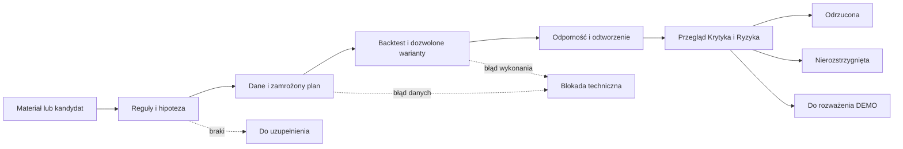

# ASTRA Pro Trading Lab — zadania i sposób pracy

**Wersja 0.1 do omówienia • część AstralJet • 19 września 2026.**

ASTRA Pro Trading Lab przyjmuje dostarczoną strategię, ustala jej jednoznaczne reguły i wykonuje badanie, które można odtworzyć. Jego wynikiem jest raport wraz z dowodami oraz wskazaniem ograniczeń. Poprawnym wynikiem może być także odrzucenie hipotezy lub stwierdzenie, że dane nie pozwalają jej ocenić.

Drugi obraz użytkownika określa dwa główne obszary: **Badanie strategii — dane i weryfikacja** oraz **Testowanie strategii — backtesty i optymalizacja**. Poniżej ich szczegółowy zakres. Opis jest specyfikacją proponowanego działania; nie oznacza, że wszystkie punkty są już wdrożone.

## 1. Granica odpowiedzialności

| Laboratorium odpowiada za | Współpracuje z | Oddzielny zakres AstralJet |
|---|---|---|
| Zrozumienie i opis reguł | Bibliotekarz i Karol | Poszukiwanie nowych kandydatów — Scout |
| Sprawdzenie przydatności danych | Usługa danych | Dostarczanie danych na żywo do wykonawcy |
| Projekt eksperymentu | Krytyk i Ryzyko | Ustalanie globalnego mandatu i budżetu — Karol |
| Backtest i kontrolowaną optymalizację | Silniki obliczeniowe | Zlecenia brokerskie i zarządzanie pozycjami — Wykonawca |
| Porównanie prób i wyjaśnienie wyniku | Krytyk | Ostateczna decyzja o uruchomieniu nowej wersji |
| Analizę odchyleń między testem a obserwacją DEMO | Monitoring | Wykonywanie i nadzorowanie operacji DEMO |

**Proponowana granica v0.1:** laboratorium nie ma narzędzia wysyłania zleceń. Może przygotować plan obserwacji DEMO i czytać jej wyniki. Dostęp wykonawczy pozostaje w odrębnym module AstralJet. Rola AI opisująca rezultat nie nadaje sama sobie tych uprawnień.

## 2. Badanie strategii — zadania AJ-05

### LAB-01 · Przyjąć materiał

Wejściem może być PDF, opis Karola, film z transkrypcją, eksport NotebookLM, istniejący kod lub karta kandydata od Scouta. Sam opis marketingowy nie musi zawierać testowalnej strategii.

Wynik: ID materiału, lista źródeł, temat i zakres badania. Przy kodzie zachowujemy wersję i pochodzenie; kod z obcego źródła wymaga przeglądu przed uruchomieniem w odizolowanym środowisku.

### LAB-02 · Sprawdzić źródła i kompletność

Badacz wskazuje, które reguły występują w źródle, a których brakuje. Cytat prowadzi do strony lub znacznika czasu. Informacja z opracowania NotebookLM zachowuje odnośnik do oryginału. Sprzeczne wersje reguły są zapisane jako sprzeczność.

Wynik: tabela reguła → źródło → fragment → brak/niejednoznaczność. Nieczytelny PDF to problem importu; nie jest argumentem za odrzuceniem strategii.

### LAB-03 · Zbudować specyfikację

Należy ustalić:

- instrument i jego rodzaj, miejsce wykonania, interwał, sesję oraz strefę czasową;
- warunki sygnału, moment jego poznania, najwcześniejszy możliwy moment wejścia i sposób realizacji;
- warunki wyjścia, stop, cel, limit czasu i zachowanie przy równoczesnych warunkach wyjścia;
- wielkość pozycji, maksymalną liczbę pozycji i reguły ponownego wejścia;
- filtry, wykluczenia i zależności od informacji technicznych, fundamentalnych, news lub makro;
- koszty i ograniczenia wykonania odpowiednie do instrumentu;
- zachowanie przy brakach danych, lukach cenowych i niedostępności rynku.

Wynik: STRAT w konkretnej wersji. Nie stosujemy uniwersalnego domyślnego stopa lub wielkości pozycji, aby „dało się uruchomić test”. Istotne uzupełnienie omawiamy z Karolem i oznaczamy jako adaptację, nie oryginalną regułę autora.

### LAB-04 · Wyjaśnić hipotezę

Oddzielamy mechanizm, który ma przynosić wynik, od opisu sygnału. Pytamy, w jakich warunkach strategia powinna działać, kiedy może przestać działać i jaki prosty punkt odniesienia pozwoli ją ocenić.

Wynik: hipoteza z przewidywanymi ograniczeniami. Uzasadnienie ekonomiczne jest argumentem do sprawdzenia, nie dowodem przewagi.

### LAB-05 · Uzgodnić plan eksperymentu

Przed obejrzeniem wyniku zapisujemy okresy, podział danych, dozwolone parametry, sposób porównania, kryteria oceny i budżet. Podział uwzględnia kolejność czasu oraz zależności obserwacji. Końcową próbę odłożoną chronimy przed wykorzystaniem do strojenia.

Wynik: EXP z odnośnikiem do STRAT i wymagań DATA. Jeżeli ważne kryterium nie zostało uzgodnione, laboratorium może wykonać analizę opisową, ale nie może deklarować przejścia tego kryterium.

## 3. Testowanie strategii — zadania AJ-07

### LAB-06 · Odebrać dane

Usługa danych przekazuje konkretną wersję zbioru i raport jakości. Tester sprawdza zgodność instrumentu, zakresu, czasu i kosztów ze specyfikacją. Dane niedostępne historycznie w chwili podejmowania decyzji nie mogą wejść do sygnału tej decyzji.

Wynik: DATA-ID dopuszczony do danego eksperymentu albo techniczna blokada ze wskazaniem braków. Zbiór dobry do orientacyjnej analizy może być niewystarczający do symulacji realizacji intraday.

### LAB-07 · Sprawdzić mechanikę implementacji

Na małych, zrozumiałych przykładach sprawdzamy kolejność sygnału i wykonania, pozycję, stop, wyjście i naliczanie kosztów. Weryfikujemy m.in. przypadek dotknięcia stopa i celu w jednej świecy; przy braku danych o kolejności zdarzeń nie wybieramy po cichu korzystniejszego wyniku.

Wynik: dowód, że kod realizuje specyfikację. Pomyślny test kodu nie oznacza rentowności strategii.

### LAB-08 · Wykonać bazowy backtest

Uruchamiamy zamrożony plan na określonej wersji kodu i danych. Zachowujemy wszystkie realizacje, koszty, krzywą wyniku, ekspozycję oraz odrzucone sygnały z przyczynami.

Wynik: RUN, który da się odtworzyć. Raport zawiera status techniczny, niepewności modelu realizacji i informację, które dane są uproszczeniem.

### LAB-09 · Porównać warianty i optymalizować

Zmiana parametrów jest dopuszczona w granicach zapisanych w EXP. Rejestrujemy pełny zbiór prób, koszt obliczeń oraz kryterium wyboru. Wszystkie warianty korzystają z porównywalnych warunków danych i kosztów albo różnice są jawnie opisane.

Wynik: zestaw porównań i uzasadnienie wyboru lub rezygnacji. Najlepszy wynik spośród wielu prób nie jest automatycznie najlepszą prognozą przyszłości. Kontrola selekcji wariantów wynika z problemu opisanego w [The Probability of Backtest Overfitting](https://www.davidhbailey.com/dhbpapers/backtest-prob.pdf).

### LAB-10 · Sprawdzić odporność i okres poza strojeniem

Zakres ustalamy wcześniej i dostosowujemy do strategii. Może obejmować zmianę kosztów, poślizgu, sąsiednich parametrów, podokresów, opóźnienia wykonania, zmienności lub braków danych. Brak możliwości przeprowadzenia wymaganej próby jest ograniczeniem raportu.

Wynik: ocena stabilności i ograniczeń. Nie ustalamy w tym dokumencie jednego progu zysku, Sharpe’a czy liczby transakcji dla wszystkich rynków i horyzontów.

### LAB-11 · Oddać wynik do przeglądu

Krytyk otrzymuje pełne dane o eksperymencie, włącznie z nieudanymi wariantami, a Ryzyko — wynik oraz założenia potencjalnego dalszego użycia. Opinia LLM nie zastępuje sprawdzeń liczbowych.

Wynik: REVIEW i lista konkretnych powodów dopuszczenia do rozważenia następnego etapu, odrzucenia lub braku rozstrzygnięcia. Sam laborant nie zatwierdza własnego badania do handlu.

### LAB-12 · Odtworzyć i wydać raport

Drugi przebieg korzysta z tych samych wersji i parametrów. Różnicę wyniku porównujemy z wcześniej określoną tolerancją; źródła losowości i ich ustawienia zapisujemy, jeśli występują.

Wynik: kompletny pakiet badania, który można sprawdzić bez przekopywania historii rozmów.

## 4. Minimalny komplet dokumentów

| Dokument | Co musi być w środku |
|---|---|
| **Karta źródła SRC** | Pochodzenie, autor, data, fragmenty i wersja materiału |
| **Karta strategii STRAT** | Hipoteza, reguły, instrument, koszty, ograniczenia i niejednoznaczności |
| **Karta danych DATA** | Dokładny zbiór, hash, zakres, czas dostępności i transformacje |
| **Plan EXP** | Kryteria przed wynikiem, podział danych, parametry i historia prób |
| **Raport RUN** | Wersja kodu/środowiska, wynik, koszty, realizacje, błędy i odtworzenie |
| **Przegląd REVIEW** | Sprawdzenia Krytyka, ograniczenia i wymagane działania |
| **Decyzja** | Autor, data, uzasadnienie i dopuszczony następny etap |

Proponowane pliki jednego eksperymentu — nie utworzone testy ani wyniki:

```text
EXP-0001/
  source-register.md
  strategy.md
  data-manifest.json
  experiment-plan.md
  runs/
    RUN-0001/
      run-manifest.json
      trades.csv
      metrics.json
      report.md
  review.md
  decision.md
```

Pełne dane rynkowe mogą pozostawać poza repo. Manifest wskazuje ich wersję i lokalizację. Rozmowy służą wypracowaniu decyzji; trwałe dokumenty i artefakty są zapisem pracy.

## 5. Stan techniczny a wynik badania

To dwa oddzielne pola. Ich połączenie powodowałoby mylenie awarii procesu ze słabą strategią.

| Stan zadania | Znaczenie |
|---|---|
| NOWE / W_KOLEJCE | Zadanie jeszcze nie pracuje |
| W_TRAKCIE | Trwa konkretny etap |
| ZABLOKOWANE | Brakuje danych, reguł, uprawnienia lub rozliczenia; zapisano sposób wznowienia |
| BŁĄD | Próba nie zakończyła się poprawnie technicznie |
| ZAKOŃCZONE | Wymagane artefakty powstały i przeszły kontrolę techniczną |
| NIEAKTUALNE | Zmieniła się strategia, dane, kod lub założenie wymagające ponownego badania |
| ANULOWANE | Zadanie przerwano świadomą decyzją |

| Wynik merytoryczny | Znaczenie |
|---|---|
| NIEOCENIONA | Nie ma jeszcze podstaw do oceny |
| DO_UZUPEŁNIENIA | Niekompletny opis lub materiał |
| ODRZUCONA | W poprawnie wykonanym badaniu nie przeszła ustalonych kryteriów |
| NIEROZSTRZYGNIĘTA | Poprawna analiza nie daje wystarczającej podstawy do wniosku |
| DO_ROZWAŻENIA_DEMO | Spełniono uzgodnione kryteria badawcze; potrzebna osobna decyzja o konkretnym mandacie |

Przykład: poprawny raport o słabym wyniku ma `ZAKOŃCZONE + ODRZUCONA`. Awaria importu ma `ZABLOKOWANE + NIEOCENIONA`. Ukończony backtest bez wystarczających danych może mieć `ZAKOŃCZONE + NIEROZSTRZYGNIĘTA`.



## 6. Zależności laboratorium

| Zależność | Wymagana kiedy | Co robimy przy braku |
|---|---|---|
| Tekst i pochodzenie reguł | Przy odtwarzaniu strategii z materiału | Lista braków; brak zgadywania |
| Karta własnej hipotezy | Przy własnym pomyśle bez publikacji | Zapis autorstwa, założeń i sposobu powstania |
| Dane i model kosztów | Do testu określonego instrumentu | Zatrzymanie testu albo wyraźnie oznaczona analiza uproszczona, bez deklaracji pełnej weryfikacji |
| Zamrożony plan | Przed właściwym porównaniem | Najpierw zapis planu; podglądy wcześniejszych wyników ujawnione |
| Scout | Tylko przy automatycznym wyszukiwaniu nowych strategii | Możliwy ręczny materiał Karola |
| Fundamenty / news / makro | Gdy wykorzystuje je reguła lub kryterium | Brak wymaganego wejścia blokuje ten eksperyment, opcjonalny kontekst można pominąć z oznaczeniem |
| Model LLM | Przy zadaniach interpretacji i syntezy | Gotowy test liczbowy nie musi czekać na model, jeżeli ma kompletne wejścia i mieści się w upoważnieniu |
| Budżet AI i zasoby | Przed płatną operacją lub kosztownym zadaniem | Jawna blokada; brak samodzielnego podnoszenia limitu |
| Przegląd Krytyka / Ryzyka | Przed rozważeniem następnego etapu | Raport pozostaje nieprzyjęty do tego etapu |
| Połączenie brokerskie | Do odczytu obserwacji DEMO | Historyczny test na kompletnym lokalnym zbiorze może działać dalej |

## 7. Informacje potrzebne użytkownikowi w istniejącym widoku laboratorium

To wymagania informacyjne do obecnego produktu, nie projekt nowego dashboardu.

1. **Co badamy:** nazwa, wersja, źródło, właściciel i konkretne pytanie.
2. **Na jakim etapie jesteśmy:** osobno stan zadania i wynik badania, data ostatniej aktualizacji.
3. **Co blokuje pracę:** dokładna przyczyna, brakujące wejście, następna czynność i osoba odpowiedzialna.
4. **Co już powstało:** specyfikacja, dane, plan, raport, transakcje i przegląd.
5. **Ile to kosztowało:** rozliczone użycie, aktywna rezerwacja, koszt nieuzgodniony i obowiązujący limit.
6. **Co można zrobić dalej:** uzupełnić regułę, ponowić po naprawie, zlecić przegląd lub przedstawić Karolowi plan DEMO.

Przycisk „ponów” nie może powielać niepewnego płatnego wywołania. Przycisk „zakończono” nie oznacza „strategia zyskowna”. Raport zawsze odsyła do dokładnych wersji wejść.

## 8. Odbiór pierwszej wersji laboratorium

Pierwsza wersja jest odebrana, gdy **jedna uzgodniona strategia** przejdzie cały proces bez ręcznego dopowiadania wyników i z następującymi dowodami:

- pochodzenie każdej istotnej reguły albo jawne autorstwo własnej hipotezy;
- specyfikacja rozstrzygająca wymagane warunki wejścia, wyjścia, kosztów i ryzyka;
- wersjonowane dane z raportem jakości;
- plan i kryteria zapisane przed ocenianym wynikiem;
- poprawna mechanika obliczeń i pełna lista prób;
- drugi przebieg odtwarzający wynik w ustalonej tolerancji;
- przegląd metodologii i ograniczeń;
- koszt i stan każdego płatnego wywołania możliwy do wyjaśnienia;
- czytelny raport dla Karola i jeden następny krok.

Odbiór **nie wymaga dodatniego wyniku strategii**. Wymaga wiarygodnego procesu, który potrafi także powiedzieć „nie wiemy” lub „odrzucamy”.

Minimalne przypadki kontrolne dla przyszłej implementacji: brak cytatu, brak danych, błędna strefa czasowa, użycie przyszłej informacji, niejednoznaczna realizacja w świecy, duplikat zlecenia badania, limit kosztu, niepewne rozliczenie, zmiana wersji po teście oraz niedozwolone żądanie zlecenia brokerskiego w materiale źródłowym. To lista do wdrożenia i sprawdzenia, nie deklaracja wykonanych testów.

## 9. Pierwsza rozmowa wdrożeniowa

Do wyboru są dwa wejścia do tego samego procesu:

- **Istniejąca strategia z repo** — najpierw odtworzyć kod i wynik; dobry wariant do odbioru działania laboratorium.
- **Strategia z nowego materiału Karola** — najpierw sprawdzić kompletność źródła; dobry wariant do sprawdzenia pracy Badacza.

Proponuję najpierw istniejącą strategię z kompletnymi regułami, a potem materiał z filmu. Wybór konkretnej strategii, danych i kryteriów pozostaje do wspólnego ustalenia. Nie wybieramy jej tutaj na podstawie chwilowego zysku DEMO.

Naprawa rozliczeń AI, importu PDF i cytatów pozostaje techniczną zależnością w zakresie, w którym uniemożliwia ten przebieg. Nie uruchomiono nowych eksperymentów ani płatnych wywołań w ramach przygotowania tego dokumentu.

[Cała struktura AstralJet i karty ról](ASTRALJET_STRUKTURA_v0.1.md).
