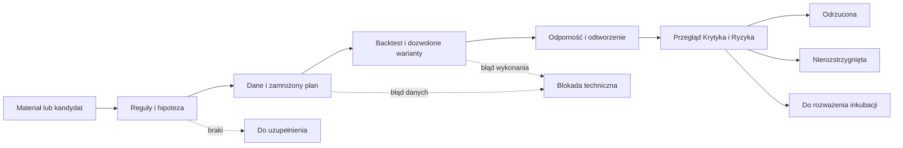

# ASTRA Pro Trading Lab — zadania i sposób pracy

**Wersja 0.2 • część AstralJet • 19 września 2026 • specyfikacja do wdrożenia.**

ASTRA Pro Trading Lab przyjmuje dostarczoną strategię, ustala jej jednoznaczne reguły i wykonuje badanie, które można odtworzyć. Jego wynikiem jest raport wraz z dowodami oraz wskazaniem ograniczeń. Poprawnym wynikiem może być także odrzucenie hipotezy lub stwierdzenie, że dane nie pozwalają jej ocenić.

Drugi obraz użytkownika określa dwa główne obszary: **Badanie strategii — dane i weryfikacja** oraz **Testowanie strategii — backtesty i optymalizacja**. Poniżej ich szczegółowy zakres. Opis jest specyfikacją docelowego działania; nie oznacza, że wszystkie punkty są już wdrożone.

## 1. Granica odpowiedzialności

| Laboratorium odpowiada za | Współpracuje z | Oddzielny zakres AstralJet |
|---|---|---|
| Zrozumienie i opis reguł | Bibliotekarz i Karol | Poszukiwanie nowych kandydatów — Scout |
| Sprawdzenie przydatności danych | Usługa danych | Dostarczanie danych na żywo do wykonawcy |
| Projekt eksperymentu | Krytyk i Ryzyko | Ustalanie globalnego mandatu i budżetu — Karol |
| Backtest i kontrolowaną optymalizację | Silniki obliczeniowe | Zlecenia brokerskie i zarządzanie pozycjami — Wykonawca |
| Porównanie prób i wyjaśnienie wyniku | Krytyk | Ostateczna decyzja o uruchomieniu nowej wersji |
| Analizę odchyleń między testem a obserwacją DEMO | Monitoring | Wykonywanie i nadzorowanie operacji DEMO |

**Granica zatwierdzona przez Karola w v0.2:** laboratorium nie ma narzędzia wysyłania zleceń. Może przygotować plan inkubacji i czytać jej wyniki. Ciągłą symulację oraz brokerskie DEMO prowadzi osobny Wykonawca AJ-15. Dostęp wykonawczy pozostaje w odrębnym module AstralJet. Rola AI opisująca rezultat nie nadaje sama sobie tych uprawnień.

## 2. Badanie strategii — zadania AJ-05

### LAB-01 · Przyjąć materiał

**Odpowiedzialny:** AJ-02 + AJ-05

**Wejście:** Materiał lub kod z wersją.

**Przekazanie:** SRC i zakres pytania.

**Kryterium odbioru:** Istnieje odwołanie do odczytanego materiału; brak odczytu pozostaje jawny.

Wejściem może być PDF, opis Karola, film z transkrypcją, eksport NotebookLM, istniejący kod lub karta kandydata od Scouta. Sam opis marketingowy nie musi zawierać testowalnej strategii.

Wynik: ID materiału, lista źródeł, temat i zakres badania. Przy kodzie zachowujemy wersję i pochodzenie; kod z obcego źródła wymaga przeglądu przed uruchomieniem w odizolowanym środowisku.

### LAB-02 · Sprawdzić źródła i kompletność

**Odpowiedzialny:** AJ-05

**Wejście:** SRC i fragmenty.

**Przekazanie:** Mapa reguł, braków i sprzeczności.

**Kryterium odbioru:** Każda reguła ma cytat albo oznaczone autorstwo; nie domyślamy się nieznanych szczegółów.

Badacz wskazuje, które reguły występują w źródle, a których brakuje. Cytat prowadzi do strony lub znacznika czasu. Informacja z opracowania NotebookLM zachowuje odnośnik do oryginału. Sprzeczne wersje reguły są zapisane jako sprzeczność.

Wynik: tabela reguła → źródło → fragment → brak/niejednoznaczność. Nieczytelny PDF to problem importu; nie jest argumentem za odrzuceniem strategii.

### LAB-03 · Zbudować specyfikację

**Odpowiedzialny:** AJ-05

**Wejście:** Mapa reguł i decyzje Karola.

**Przekazanie:** STRAT w wersji.

**Kryterium odbioru:** Wejścia, wyjścia, czas, pozycja i zależności są jednoznaczne albo karta pozostaje DO_UZUPEŁNIENIA.

Należy ustalić:

- instrument i jego rodzaj, miejsce wykonania, interwał, sesję oraz strefę czasową;
- warunki sygnału, moment jego poznania, najwcześniejszy możliwy moment wejścia i sposób realizacji;
- warunki wyjścia, stop, cel, limit czasu i zachowanie przy równoczesnych warunkach wyjścia;
- wielkość pozycji, maksymalną liczbę pozycji i reguły ponownego wejścia;
- filtry, wykluczenia i zależności od informacji technicznych, fundamentalnych, news lub makro;
- koszty i ograniczenia wykonania odpowiednie do instrumentu;
- zachowanie przy brakach danych, lukach cenowych i niedostępności rynku.

Wynik: STRAT w konkretnej wersji. Nie stosujemy uniwersalnego domyślnego stopa lub wielkości pozycji, aby „dało się uruchomić test”. Istotne uzupełnienie omawiamy z Karolem i oznaczamy jako adaptację, nie oryginalną regułę autora.

### LAB-04 · Wyjaśnić hipotezę

**Odpowiedzialny:** AJ-05

**Wejście:** STRAT i źródła.

**Przekazanie:** Hipoteza i punkt odniesienia.

**Kryterium odbioru:** Rozróżniono przewidywany mechanizm od dowodu jego skuteczności.

Oddzielamy mechanizm, który ma przynosić wynik, od opisu sygnału. Pytamy, w jakich warunkach strategia powinna działać, kiedy może przestać działać i jaki prosty punkt odniesienia pozwoli ją ocenić.

Wynik: hipoteza z przewidywanymi ograniczeniami. Uzasadnienie ekonomiczne jest argumentem do sprawdzenia, nie dowodem przewagi.

### LAB-05 · Uzgodnić plan eksperymentu

**Odpowiedzialny:** AJ-05 + AJ-07; uzgodnienie z Karolem

**Wejście:** STRAT, wymagania danych, znane ograniczenia i limit kosztu.

**Przekazanie:** EXP z określonym zakresem prób.

**Kryterium odbioru:** Kryteria zapisane przed wynikiem; wcześniejsze wykorzystanie danych ujawnione. Plan i wersje są zamrożone przed uruchomieniem, po potwierdzeniu DATA w LAB-06.

Przed obejrzeniem wyniku zapisujemy okresy, podział danych, dozwolone parametry, sposób porównania, kryteria oceny i budżet. Podział uwzględnia kolejność czasu oraz zależności obserwacji. Końcową próbę odłożoną chronimy przed wykorzystaniem do strojenia.

Wynik: EXP z odnośnikiem do STRAT i wymagań DATA. Jeżeli ważne kryterium nie zostało uzgodnione, laboratorium może wykonać analizę opisową, ale nie może deklarować przejścia tego kryterium.

## 3. Testowanie strategii — zadania AJ-07

### LAB-06 · Odebrać dane

**Odpowiedzialny:** AJ-06 + AJ-07

**Wejście:** Wymagania EXP oraz dostarczone dane.

**Przekazanie:** DATA dopuszczona do celu albo blokada.

**Kryterium odbioru:** Instrument, czas, zakres i koszty zgodne; hash DATA włączony do zamrożonego EXP przed LAB-08.

Usługa danych przekazuje konkretną wersję zbioru i raport jakości. Tester sprawdza zgodność instrumentu, zakresu, czasu i kosztów ze specyfikacją. Dane niedostępne historycznie w chwili podejmowania decyzji nie mogą wejść do sygnału tej decyzji.

Wynik: DATA-ID dopuszczony do danego eksperymentu albo techniczna blokada ze wskazaniem braków. Zbiór dobry do orientacyjnej analizy może być niewystarczający do symulacji realizacji intraday.

### LAB-07 · Sprawdzić mechanikę implementacji

**Odpowiedzialny:** AJ-07

**Wejście:** STRAT, kod i małe przypadki kontrolne.

**Przekazanie:** Wyniki sprawdzeń mechaniki.

**Kryterium odbioru:** Wykazano zgodność reguł i księgowania; nie wystarczy brak błędu uruchomienia.

Na małych, zrozumiałych przykładach sprawdzamy kolejność sygnału i wykonania, pozycję, stop, wyjście i naliczanie kosztów. Weryfikujemy m.in. przypadek dotknięcia stopa i celu w jednej świecy; przy braku danych o kolejności zdarzeń nie wybieramy po cichu korzystniejszego wyniku.

Wynik: dowód, że kod realizuje specyfikację. Pomyślny test kodu nie oznacza rentowności strategii.

### LAB-08 · Wykonać bazowy backtest

**Odpowiedzialny:** AJ-07

**Wejście:** Zamrożone EXP/STRAT/DATA i kod.

**Przekazanie:** RUN, transakcje, krzywa, koszty, odrzucenia.

**Kryterium odbioru:** Wynik raportu uzgadnia się z księgą; model realizacji opisany.

Uruchamiamy zamrożony plan na określonej wersji kodu i danych. Zachowujemy wszystkie realizacje, koszty, krzywą wyniku, ekspozycję oraz odrzucone sygnały z przyczynami.

Wynik: RUN, który da się odtworzyć. Raport zawiera status techniczny, niepewności modelu realizacji i informację, które dane są uproszczeniem.

### LAB-09 · Porównać warianty i optymalizować

**Odpowiedzialny:** AJ-07

**Wejście:** Dozwolony zakres wariantów EXP.

**Przekazanie:** Rejestr wszystkich RUN i wybór albo rezygnacja.

**Kryterium odbioru:** Nie ukryto przegranych wariantów; nowe pytanie tworzy nowy eksperyment.

Zmiana parametrów jest dopuszczona w granicach zapisanych w EXP. Rejestrujemy pełny zbiór prób, koszt obliczeń oraz kryterium wyboru. Wszystkie warianty korzystają z porównywalnych warunków danych i kosztów albo różnice są jawnie opisane.

Wynik: zestaw porównań i uzasadnienie wyboru lub rezygnacji. Najlepszy wynik spośród wielu prób nie jest automatycznie najlepszą prognozą przyszłości. Kontrola selekcji wariantów wynika z problemu opisanego w [The Probability of Backtest Overfitting](https://www.davidhbailey.com/dhbpapers/backtest-prob.pdf).

### LAB-10 · Sprawdzić odporność i okres poza strojeniem

**Odpowiedzialny:** AJ-07

**Wejście:** Wybrany wariant i plan sprawdzeń odporności.

**Przekazanie:** Raport ograniczeń oraz próby poza strojeniem.

**Kryterium odbioru:** Każdy wymagany scenariusz ma wynik lub jawną blokadę; brak automatycznego progu z PDF.

Zakres ustalamy wcześniej i dostosowujemy do strategii. Może obejmować zmianę kosztów, poślizgu, sąsiednich parametrów, podokresów, opóźnienia wykonania, zmienności lub braków danych. Brak możliwości przeprowadzenia wymaganej próby jest ograniczeniem raportu.

Wynik: ocena stabilności i ograniczeń. Nie ustalamy w tym dokumencie jednego progu zysku, Sharpe’a czy liczby transakcji dla wszystkich rynków i horyzontów.

### LAB-11 · Oddać wynik do przeglądu

**Odpowiedzialny:** AJ-08 + AJ-09

**Wejście:** Pełny pakiet i historia prób.

**Przekazanie:** REVIEW oraz warunki dalszego rozważenia.

**Kryterium odbioru:** Ocena wskazuje dowody, braki i właściciela następnego kroku; rekomendacja warunkowa do czasu LAB-12.

Krytyk otrzymuje pełne dane o eksperymencie, włącznie z nieudanymi wariantami, a Ryzyko — wynik oraz założenia potencjalnego dalszego użycia. Opinia LLM nie zastępuje sprawdzeń liczbowych.

Wynik: REVIEW i lista konkretnych powodów dopuszczenia do rozważenia następnego etapu, odrzucenia lub braku rozstrzygnięcia. Sam laborant nie zatwierdza własnego badania do handlu.

### LAB-12 · Odtworzyć i wydać raport

**Odpowiedzialny:** AJ-07; odbiór AJ-08

**Wejście:** Te same wersje, parametry i tolerancja.

**Przekazanie:** Raport odtworzenia i końcowy pakiet.

**Kryterium odbioru:** Drugi przebieg zgodny; końcowa REVIEW uwzględnia jego wynik. Dopiero potem można rozważać mandat inkubacji.

Drugi przebieg korzysta z tych samych wersji i parametrów. Różnicę wyniku porównujemy z wcześniej określoną tolerancją; źródła losowości i ich ustawienia zapisujemy, jeśli występują.

Wynik: kompletny pakiet badania, który można sprawdzić bez przekopywania historii rozmów.

## 4. Minimalny komplet dokumentów

| Dokument | Co musi być w środku |
|---|---|
| **Karta źródła SRC** | Pochodzenie, autor, data, fragmenty i wersja materiału |
| **Karta strategii STRAT** | Hipoteza, reguły, instrument, koszty, ograniczenia i niejednoznaczności |
| **Karta danych DATA** | Dokładny zbiór, hash, zakres, czas dostępności i transformacje |
| **Plan EXP** | Kryteria przed wynikiem, podział danych, parametry i historia prób |
| **Raport RUN** | Wersja kodu/środowiska, wynik, koszty, realizacje, błędy i odtworzenie |
| **Przegląd REVIEW** | Sprawdzenia Krytyka, ograniczenia i wymagane działania |
| **Decyzja** | Autor, data, uzasadnienie i dopuszczony następny etap |

Proponowane pliki jednego eksperymentu — nie utworzone testy ani wyniki:

```text
EXP-0001/
  source-register.md
  strategy.md
  data-manifest.json
  experiment-plan.md
  runs/
    RUN-0001/
      run-manifest.json
      trades.csv
      metrics.json
      report.md
  review.md
  decision.md
```

Pełne dane rynkowe mogą pozostawać poza repo. Manifest wskazuje ich wersję i lokalizację. Rozmowy służą wypracowaniu decyzji; trwałe dokumenty i artefakty są zapisem pracy.

## 5. Stan techniczny a wynik badania

To dwa oddzielne pola. Ich połączenie powodowałoby mylenie awarii procesu ze słabą strategią.

| Stan zadania | Znaczenie |
|---|---|
| NOWE / W_KOLEJCE | Zadanie jeszcze nie pracuje |
| W_TRAKCIE | Trwa konkretny etap |
| ZABLOKOWANE | Brakuje danych, reguł, uprawnienia lub rozliczenia; zapisano sposób wznowienia |
| BŁĄD | Próba nie zakończyła się poprawnie technicznie |
| ZAKOŃCZONE | Wymagane artefakty powstały i przeszły kontrolę techniczną |
| NIEAKTUALNE | Zmieniła się strategia, dane, kod lub założenie wymagające ponownego badania |
| ANULOWANE | Zadanie przerwano świadomą decyzją |

| Wynik merytoryczny | Znaczenie |
|---|---|
| NIEOCENIONA | Nie ma jeszcze podstaw do oceny |
| DO_UZUPEŁNIENIA | Niekompletny opis lub materiał |
| ODRZUCONA | W poprawnie wykonanym badaniu nie przeszła ustalonych kryteriów |
| NIEROZSTRZYGNIĘTA | Poprawna analiza nie daje wystarczającej podstawy do wniosku |
| DO_ROZWAŻENIA_INKUBACJI | Spełniono uzgodnione kryteria badawcze; potrzebna osobna decyzja o konkretnym mandacie |

Przykład: poprawny raport o słabym wyniku ma `ZAKOŃCZONE + ODRZUCONA`. Awaria importu ma `ZABLOKOWANE + NIEOCENIONA`. Ukończony backtest bez wystarczających danych może mieć `ZAKOŃCZONE + NIEROZSTRZYGNIĘTA`.



## 6. Zależności laboratorium

| Zależność | Wymagana kiedy | Co robimy przy braku |
|---|---|---|
| Tekst i pochodzenie reguł | Przy odtwarzaniu strategii z materiału | Lista braków; brak zgadywania |
| Karta własnej hipotezy | Przy własnym pomyśle bez publikacji | Zapis autorstwa, założeń i sposobu powstania |
| Dane i model kosztów | Do testu określonego instrumentu | Zatrzymanie testu albo wyraźnie oznaczona analiza uproszczona, bez deklaracji pełnej weryfikacji |
| Zamrożony plan | Przed właściwym porównaniem | Najpierw zapis planu; podglądy wcześniejszych wyników ujawnione |
| Scout | Tylko przy automatycznym wyszukiwaniu nowych strategii | Możliwy ręczny materiał Karola |
| Fundamenty / news / makro | Gdy wykorzystuje je reguła lub kryterium | Brak wymaganego wejścia blokuje ten eksperyment, opcjonalny kontekst można pominąć z oznaczeniem |
| Model LLM | Przy zadaniach interpretacji i syntezy | Gotowy test liczbowy nie musi czekać na model, jeżeli ma kompletne wejścia i mieści się w upoważnieniu |
| Budżet AI i zasoby | Przed płatną operacją lub kosztownym zadaniem | Jawna blokada; brak samodzielnego podnoszenia limitu |
| Przegląd Krytyka / Ryzyka | Przed rozważeniem następnego etapu | Raport pozostaje nieprzyjęty do tego etapu |
| Połączenie brokerskie | Do odczytu obserwacji DEMO | Historyczny test na kompletnym lokalnym zbiorze może działać dalej |

## 7. Informacje potrzebne użytkownikowi w istniejącym widoku laboratorium

To wymagania informacyjne do obecnego produktu, nie projekt nowego dashboardu.

1. **Co badamy:** nazwa, wersja, źródło, właściciel i konkretne pytanie.
2. **Na jakim etapie jesteśmy:** osobno stan zadania i wynik badania, data ostatniej aktualizacji.
3. **Co blokuje pracę:** dokładna przyczyna, brakujące wejście, następna czynność i osoba odpowiedzialna.
4. **Co już powstało:** specyfikacja, dane, plan, raport, transakcje i przegląd.
5. **Ile to kosztowało:** rozliczone użycie, aktywna rezerwacja, koszt nieuzgodniony i obowiązujący limit.
6. **Co można zrobić dalej:** uzupełnić regułę, ponowić po naprawie, zlecić przegląd lub przedstawić Karolowi plan DEMO.

Przycisk „ponów” nie może powielać niepewnego płatnego wywołania. Przycisk „zakończono” nie oznacza „strategia zyskowna”. Raport zawsze odsyła do dokładnych wersji wejść.

## 8. Przyszły odbiór pierwszej działającej wersji laboratorium

To odbiór przyszłej implementacji, nie bieżącej dokumentacji. Pierwsza działająca wersja będzie odebrana, gdy **jedna uzgodniona strategia** przejdzie cały proces bez ręcznego dopowiadania wyników i z następującymi dowodami:

- pochodzenie każdej istotnej reguły albo jawne autorstwo własnej hipotezy;
- specyfikacja rozstrzygająca wymagane warunki wejścia, wyjścia, kosztów i ryzyka;
- wersjonowane dane z raportem jakości;
- plan i kryteria zapisane przed ocenianym wynikiem;
- poprawna mechanika obliczeń i pełna lista prób;
- drugi przebieg odtwarzający wynik w ustalonej tolerancji;
- przegląd metodologii i ograniczeń;
- koszt i stan każdego płatnego wywołania możliwy do wyjaśnienia;
- czytelny raport dla Karola i jeden następny krok.

Odbiór **nie wymaga dodatniego wyniku strategii**. Wymaga wiarygodnego procesu, który potrafi także powiedzieć „nie wiemy” lub „odrzucamy”.

Minimalne przypadki kontrolne dla przyszłej implementacji: brak cytatu, brak danych, błędna strefa czasowa, użycie przyszłej informacji, niejednoznaczna realizacja w świecy, duplikat zlecenia badania, limit kosztu, niepewne rozliczenie, zmiana wersji po teście oraz niedozwolone żądanie zlecenia brokerskiego w materiale źródłowym. To lista do wdrożenia i sprawdzenia, nie deklaracja wykonanych testów.


## 9. Zakres bieżącego etapu

Karol wybrał najpierw dokumentację. Niniejsza specyfikacja rozwija istniejące role i kod, ale ich nie uruchamia. Proponowane nazwy rekordów i statusów nie zmieniają obecnego API ani bazy. Dawna etykieta dokumentacji DO_ROZWAŻENIA_DEMO została poszerzona do DO_ROZWAŻENIA_INKUBACJI; tryb obserwacji jest odrębnym wyborem w mandacie.

LAB-05 przygotowuje plan i wymagania; LAB-06 potwierdza konkretną DATA. Ostateczne zamrożenie EXP wiąże obie wersje przed uruchomieniem LAB-08. LAB-11 może wydać ocenę warunkową; końcowa REVIEW musi uwzględniać odtworzenie z LAB-12.

## 10. Cztery różne rodzaje dowodu

| Tryb dokumentacyjny | Co faktycznie mierzymy | Kto wykonuje / kto ocenia | Ograniczenie |
|---|---|---|---|
| BACKTEST | Symulację na zamrożonej historii | AJ-07 / AJ-08 | Wynik zależy od danych, wcześniejszego strojenia, kosztów i modelu realizacji |
| LATER_DATA_REPLAY | Ponowne uruchomienie zamrożonej strategii na danych powstałych później | AJ-07 / AJ-08 | Test po fakcie nie dowodzi, że system działał bez przerwy podczas zbierania tych danych |
| PAPER_CONTINUOUS | Sygnały i symulowane realizacje rejestrowane na bieżąco | AJ-15 / AJ-07 i AJ-08 | Realizacje są modelowane, nie potwierdzane przez brokera |
| BROKER_DEMO | Zlecenia i realizacje na rachunku demonstracyjnym brokera | AJ-15 / AJ-07, AJ-08 i AJ-09 | Potwierdza działanie integracji w DEMO; nie jest wynikiem handlu realnym |

AI Trading Arena opisuje własny forward test jako ponowny przebieg na okresie, który upłynął od zakwalifikowania strategii. W AstralJet oznaczamy taki dowód jako LATER_DATA_REPLAY. [Opis autora areny](https://aitradingarena.com/)

**Inkubacja** jest etapem obserwacji z podanym trybem PAPER_CONTINUOUS albo BROKER_DEMO. Późniejszy replay może ją uzupełniać, lecz nie zastępuje dowodu ciągłego działania. Każdy wykres pokazuje tryb, wersję, daty i źródło danych; kolor zielony/różowy może pomagać wizualnie, ale sam nie określa wiarygodności.

## 11. Metryki i sposób porównywania

Poniższe definicje są wymaganiami raportu AstralJet. Nie są ustawieniem progów rentowności. Zawsze podajemy kapitał początkowy, walutę, okres, wielkość pozycji, ekspozycję, koszty i liczbę badanych wariantów. Brak kosztu ma etykietę „nieznany”, a nie wartość zero.

| Metryka | Definicja raportowa i wymagane doprecyzowanie |
|---|---|
| Wynik netto zamkniętych transakcji | Suma wyników brutto minus prowizje, opłaty i przypisane finansowanie; poślizg i spread mogą już być zawarte w cenach realizacji — bez podwójnego odliczenia |
| Zmiana kapitału / stopa zwrotu | Zmiana equity, z jawnym ujęciem otwartych pozycji i przepływów zewnętrznych; prosty procent tylko dla stałego kapitału bez dopłat i wypłat |
| Profit Factor | Suma dodatnich wyników transakcji podzielona przez wartość bezwzględną sumy ujemnych; raport określa, czy używa wyniku brutto, czy netto po kosztach |
| PF bez strat / bez transakcji | Bez strat: „brak strat w próbie”, bez automatycznego awansu; bez transakcji: „nieobliczalny”. Nie zastępujemy ich sztuczną liczbą do rankingu |
| Win rate | Transakcje z dodatnim wynikiem netto / wszystkie zamknięte transakcje; transakcje zerowe pokazane osobno |
| Średni wynik transakcji | Wynik netto zamkniętych transakcji / ich liczba; przy zerowej liczbie brak wartości |
| Payoff | Średnia dodatnia transakcja / moduł średniej ujemnej, z tym samym sposobem ujęcia kosztów; niewystarczająca próba oznaczona |
| Maksymalne obsunięcie | Największy spadek equity od wcześniejszego szczytu: kwota i procent; częstotliwość pomiaru i ujęcie pozycji otwartych obowiązkowe |
| Liczba transakcji | Liczba zakończonych pozycji zgodnie z definicją księgi; osobno liczba realizacji, częściowych zamknięć i odrzuconych sygnałów |
| Ekspozycja i koszty | Czas w rynku, jednoczesne ryzyko/pozycje, obrót, prowizje, finansowanie, poślizg i odrzucenia |
| Punkt odniesienia | Uzasadniony dla hipotezy i instrumentu, w tym samym okresie i przy porównywalnym ryzyku; buy & hold nie jest obowiązkowy dla każdej strategii |
| Współzależność strategii | Porównanie wyrównanych w czasie zmian kapitału/zwrotów, wspólnych strat i ekspozycji; nie korelacja samych rosnących poziomów equity |

Historyczne obsunięcie dzienne nie jest automatycznie maksymalnym obsunięciem intraday. Liczba transakcji nie przesądza o liczbie niezależnych obserwacji. Dwa raporty bez zgodnych definicji nie otrzymują wspólnego rankingu.

TradingView korzysta z emulatora brokera i założeń realizacji opartych o dane wykresu. Dlatego porównanie z Astrą wymaga uzgodnienia momentu sygnału, realizacji, danych wewnątrz świecy i kosztów. Zgodność dwóch wykresów sama nie potwierdza wykonania brokerskiego. [TradingView — Strategies](https://www.tradingview.com/pine-script-docs/concepts/strategies/)

### Porównanie backtestu z inkubacją

1. Sprawdzić zgodność wersji strategii, kodu, instrumentu, sizingu i kosztów. Zmiana któregokolwiek elementu wymaga wyjaśnienia lub osobnej serii.
2. Na wspólnym okresie inkubacji porównać sygnały i realizacje z odtworzeniem zamrożonej wersji. Oddzielić różnice sygnału, czasu wykonania, ceny, kosztu oraz awarii.
3. Dla różnych okresów porównać rozkład wyników, ekspozycję, obsunięcia i warunki rynku. Nie oczekiwać pokrywania się linii ani tej samej stopy zwrotu.
4. Uwzględnić liczbę obserwacji, luki i niepewność. Zbyt krótka lub niekompletna próba kończy się NIEROZSTRZYGNIĘTA, nie automatycznym sukcesem albo porażką.

## 12. Historia prób, koszty i kryteria przed wynikiem

Nowy arkusz kosztów SRC-028 jest wejściem do kontroli LAB-06, nie zatwierdzonym profilem brokera. AJ-06 rozdziela spread, prowizję, minima, finansowanie i model poślizgu; ustala jednostki, symbol, okres oraz dowód każdej wartości. AJ-07 pokazuje osobno wynik przy założeniach i przy kosztach zweryfikowanych. Pełna lista braków arkusza znajduje się w katalogu źródeł. Koszt nieznany może pozwalać na jawnie ograniczony test mechaniki, ale blokuje wniosek o wyniku netto po rzeczywistych kosztach.

Audyt SRC-022 s. 7–8 pokazuje, dlaczego plan musi wiązać instrument, sizing i wersję silnika: runda o innym zakresie nie potwierdza ani nie obala wcześniejszego badania. SRC-024 s. 11–14 dostarcza wzorca dziennika i przeglądu tygodniowego. Ręczny zapis hipotetycznych transakcji oznaczamy jako taki; sam nie spełnia wymagania ciągłego wykonawcy PAPER_CONTINUOUS.

Każdy wariant ma własny RUN, powiązanie z EXP, parametry, datę, koszt i status. Rejestr obejmuje także próby nieudane i odrzucone. Duplikaty są łączone, a zmiana hipotezy tworzy nowy STRAT/EXP. Wyniku sprzed takiej zmiany nie przenosimy jako walidacji nowej wersji.

Plan oddziela dane do opracowania, walidacji i ewentualnego końcowego sprawdzenia. Sam podział po dacie nie dowodzi niezależności: trzeba ujawnić wcześniejsze użycie danych, zależne obserwacje i sposób doboru wariantu. Próba końcowa po wykorzystaniu do poprawiania reguł przestaje pełnić pierwotną rolę.

**Obowiązujące rozstrzygnięcie:** materiały nie narzucają Astrze PF 1,2/1,3/1,35, maksymalnego DD 10%, 600 transakcji, siedmiu strategii ani 30/60 dni inkubacji. Kryteria dobieramy do konkretnego eksperymentu przed zobaczeniem wyniku. Bez nich można sporządzić opis, ale nie orzec ich spełnienia.

Ośmiogodzinny sprint jest przykładem organizacji pracy ze źródła, a nie harmonogramem ustawionym w Astrze. Przyszła pętla ma korzystać z istniejącej kolejki, limitu prób, kosztu i trwałego postępu. Zatrzymanie modelu lub sesji nie może usuwać historii ani wymuszać powtórnego opłacenia niepewnej operacji. Koszt rozliczony, rezerwacja i koszt nieuzgodniony pozostają odrębne.

## 13. Przekazanie do Wykonawcy i powrót wyników

Warunkiem rozważenia inkubacji jest pakiet STRAT/DATA/EXP/RUN/REVIEW z wykazem ograniczeń. Karol otrzymuje cel obserwacji, proponowany tryb, wersję, instrumenty, czas przeglądu, limity oraz sposób reagowania na odchylenia. To materiał do decyzji, nie automatyczny sygnał uruchomienia.

| Etap | Odpowiedzialny | Wynik |
|---|---|---|
| Ocena badania | AJ-08 | REVIEW z dowodami i brakami |
| Ocena zakresu inkubacji | AJ-09 | RISK-DECISION i wymagania do mandatu |
| Decyzja o rozpoczęciu | Karol, zapis AJ-00/AJ-16 | MANDATE dla konkretnego trybu i wersji |
| Weryfikacja środowiska i wykonanie | AJ-15 | INCU, zapis sygnałów, prób, realizacji, pozycji i usterek |
| Monitoring | AJ-16 | Świeżość danych, zgodność ksiąg, pokrycie okresu, incydenty |
| Ponowna ocena | AJ-07 → AJ-08 → AJ-09 → Karol | Kontynuacja, uzupełnienie próby, zakończenie albo nowy projekt strategii |

Mandat określa oddzielnie wstrzymanie nowych wejść, obsługę oczekujących zleceń i istniejących pozycji. Niepewnego wyniku zlecenia nie ponawiamy przed uzgodnieniem stanu. Restart procesu i brak danych również podlegają opisanym regułom. Lab otrzymuje odczyty i wyniki, nie narzędzie do składania zleceń.

Po zmianie strategii zaczyna się nowa seria inkubacji dla nowej wersji. Stara seria zostaje zachowana. Ukończenie inkubacji nie uruchamia handlu realnego; ten dokument nie definiuje ani nie zatwierdza takiego wdrożenia.

## 14. Przykładowa strategia przeprowadzona przez proces

**Przykład dydaktyczny EX-001, niewykonany.** Punkt wyjścia: przecięcie SMA 20/50 na BTC/USDT wymienione w SRC-007, s. 1–2, i SRC-011, slajd 5. Te materiały nie dostarczają kompletnej strategii. Przykład pokazuje obieg pracy, nie wybiera pierwszej strategii Karola i nie przypisuje jej zysku 4,74%.

| Krok | Przekazanie i zapis | Co następuje |
|---|---|---|
| 1. Przyjęcie | Karol → AJ-02: SRC-007 i SRC-011; AJ-05: CAND-EX-001 | Rejestr stron, wersji i pochodzenia |
| 2. Kompletność | AJ-05: lista braków | Brakuje m.in. miejsca obrotu, okresu, precyzyjnego wykonania, pozycji i kosztów: ZABLOKOWANE + DO_UZUPEŁNIENIA |
| 3. Projekt reguł | AJ-05 → Karol: STRAT-EX-001 v1-propozycja | Karol ocenia jawne uzupełnienia; bez decyzji przykład zatrzymuje się tutaj |
| 4. Plan | Po hipotetycznej decyzji: AJ-05/AJ-07 → EXP-EX-001 | Utrwalenie zakresu, kryteriów, limitu wariantów, kosztu i warunków odtworzenia przed wynikiem |
| 5. Dane | AJ-06 → DATA-EX-001 | Potwierdzenie miejsca obrotu, kompletności, strefy i dostępności danych; brak danych blokuje test |
| 6. Mechanika | AJ-07: małe przypadki kontrolne | Sygnał nie korzysta z przyszłości; koszty i stan pozycji zgodne z regułami |
| 7. Backtest | AJ-07 → RUN-EX-001 | Wszystkie transakcje i odrzucenia; rzeczywiste liczby pojawią się dopiero po wykonaniu testu |
| 8. Warianty i odporność | AJ-07 → kolejne RUN w tym samym EXP | Tylko zakres zatwierdzony; również niekorzystne wyniki pozostają w historii |
| 9. Przegląd i odtworzenie | AJ-08 oraz AJ-07 → REVIEW i drugi przebieg | Błąd techniczny wraca do naprawy, a poprawny ujemny wynik może zakończyć się odrzuceniem według ustalonego kryterium |
| 10. Decyzja o inkubacji | AJ-09 → Karol → MANDATE-EX-001 | Wyłącznie jeżeli zebrane dowody spełniają uzgodnione warunki; przykład nie zawiera takiej rzeczywistej decyzji |
| 11. Obserwacja | AJ-15/AJ-16 → INCU-EX-001 | Wybrany tryb PAPER_CONTINUOUS albo BROKER_DEMO, wersja i pełny dziennik |
| 12. Ponowna ocena | AJ-07/AJ-08/AJ-09 → Karol | Raport zgodności i ograniczeń; kontynuacja lub zamknięcie serii; brak automatycznego przejścia na realne pieniądze |

**Ilustracyjny wariant reguł do kroku 3:** rynek spot, wyłącznie pozycje długie, decyzja po zamknięciu świecy godzinowej UTC; wejście przy SMA20 przechodzącej z ≤SMA50 na >SMA50, najwcześniej na otwarciu następnej świecy; wyjście przy przeciwnym przecięciu, jedna pozycja, bez dokładania. Wszystkie te doprecyzowania poza okresami SMA są autorskimi założeniami przykładu. Brak stopa w źródle zapisujemy jawnie — nie dopisujemy go jako rzekomej reguły autora.

Pozostające wartości — dostawca, symbol właściwy dla miejsca obrotu, daty, kapitał, wielkość pozycji, koszty, reguła pozycji otwartej na końcu oraz kryteria badania — są polami wymaganymi do uzgodnienia. **Ten wariant nie jest gotową instrukcją uruchomienia.** Cel przykładu to pokazanie, że system potrafi zatrzymać niekompletny pomysł i wskazać właściciela każdego uzupełnienia. Własny wariant nie może być przedstawiany jako wierna replikacja publikacji.

## 15. Scenariusze odbioru dokumentacji i przyszłej implementacji

Poniższe scenariusze prześledzono jako kontrolę spójności opisu. Nie są wykonanymi backtestami ani testami działającej aplikacji.

| ID | Sytuacja | Oczekiwany stan i właściciel następnego kroku |
|---|---|---|
| DOC-01 | Pełny pakiet, poprawny przebieg, spełnione wcześniej uzgodnione kryteria | AJ-07 wydaje RUN, AJ-08 REVIEW, AJ-09 ocenia zakres, Karol decyduje o mandacie; AJ-15 dopiero potem prowadzi inkubację |
| DOC-02 | Brak reguły wyjścia lub sizingu | ZABLOKOWANE + DO_UZUPEŁNIENIA; AJ-05 przedstawia brak i wariant uzupełnienia Karolowi |
| DOC-03 | Luka, błędna strefa lub dane z przyszłości | AJ-06/AJ-07 blokują zależny test; poprawiona DATA wymaga nowego przebiegu; poprzedni wynik zostaje oznaczony nieważnym dla tej oceny |
| DOC-04 | Wyczerpany budżet albo nierozliczona płatna odpowiedź | AJ-17 blokuje kosztową operację; AJ-01 zachowuje postęp; rozliczenie lub przyszła decyzja Karola bez samodzielnego zwiększenia limitu |
| DOC-05 | Wynik negatywny względem ustalonego kryterium przy poprawnym teście | ZAKOŃCZONE + ODRZUCONA, raport i wszystkie próby pozostają; brak przekazania do inkubacji |
| DOC-06 | Wynik poprawny technicznie, za mało dowodów | ZAKOŃCZONE + NIEROZSTRZYGNIĘTA; AJ-08 wskazuje brak podstaw, AJ-05 proponuje następny zakres |
| DOC-07 | Ponowne dostarczenie identycznego zadania | AJ-01 wiąże je z istniejącym zadaniem; nie tworzy drugiego kosztu ani operacji brokerskiej |
| DOC-08 | Reguła zmieniona po badaniu | Nowa STRAT/EXP; stary RUN zachowuje ważność tylko dla starej wersji; brak przeniesienia zgody do nowej wersji |
| DOC-09 | Materiał źródłowy żąda instalacji albo transakcji | AJ-02 zachowuje to jako treść źródła; brak wykonania polecenia; AJ-00 może przedstawić propozycję w oddzielnym zadaniu |
| DOC-10 | Brak odpowiedzi na wysłane zlecenie DEMO | AJ-15 oznacza niepewność, AJ-16 uzgadnia zapisy; brak ślepego ponowienia |
| DOC-11 | Dwa raporty różnią się instrumentem, kosztami lub modelem realizacji | AJ-07 oznacza NIEPORÓWNYWALNE; brak rankingu do czasu wyjaśnienia różnic |
| DOC-12 | Replay na późniejszych danych nazwano działającym paper tradingiem | AJ-08 koryguje rodzaj dowodu na LATER_DATA_REPLAY; brak deklaracji ciągłości działania |

Warunek odbioru dokumentacji: komplet 19 kart, 12 zadań, źródła ze wskazaniem miejsca, spójny podział Lab/Wykonawca, właściciel i rezultat każdego przekazania oraz brak przypisania wymyślonych wyników do EX-001. Faktyczny odbiór silnika i pierwszej strategii nastąpi w następnym etapie.

## 16. Następny etap — decyzje pozostawione Karolowi

Najpierw wybieramy strategię i miejsce obrotu, następnie wersję danych, zakres prób, kryteria i budżet. Daty, limity ryzyka i dostęp do rachunku nie wynikają z tego przykładu ani z PDF-ów. Stan wcześniejszych blokad importu i rozliczeń sprawdzamy tylko w zakresie potrzebnym do wybranego przebiegu.

Pełny rejestr decyzji znajduje się w [katalogu źródeł i decyzji](ASTRALJET_ZRODLA_I_DECYZJE_v0.2.md). Zależności i uprawnienia ról opisuje [struktura AstralJet](ASTRALJET_STRUKTURA_v0.2.md).
